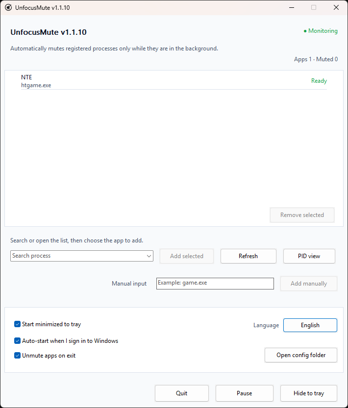

<div align="center">
  

  <h1>UnfocusMute</h1>

  <p><strong>A lightweight Windows tray app that automatically mutes selected games and apps when they lose focus.</strong></p>

  <p>
    English · <a href="docs/README_ko.md">한국어</a> · <a href="docs/README_ja.md">日本語</a> · <a href="docs/README_zh-CN.md">简体中文</a> · <a href="docs/README_es.md">Español</a> · <a href="docs/README_fr.md">Français</a> · <a href="docs/README_pt.md">Português</a> · <a href="docs/README_hi.md">हिन्दी</a> · <a href="docs/README_ar.md">العربية</a>
  </p>

  <p>
    <a href="https://github.com/ilsd7/UnfocusMute/actions/workflows/ci.yml"></a>
    &nbsp;
    
    &nbsp;
    <a href="LICENSE"></a>
  </p>

  <p>Fully local &nbsp;·&nbsp; No network access &nbsp;·&nbsp; No telemetry &nbsp;·&nbsp; No installation required</p>

  <p>
    <a href="https://github.com/ilsd7/UnfocusMute/releases/latest/download/UnfocusMute-windows-x64.zip">Download</a>
    · <a href="#usage">Usage</a>
    · <a href="#security-and-privacy">Privacy</a>
    · <a href="LICENSE">Apache-2.0</a>
  </p>
</div>

---

UnfocusMute is a small, lightweight Windows tray app that automatically mutes selected games and apps when they go into the background, then unmutes them when they return to the foreground.

If a game has no background mute option, you can leave it running and use `Alt`+`Tab` to work in another window without hearing the game. The same feature works with browsers and media players. Apps you mute yourself stay muted.

The native Rust executable is about 600 KB.

<p align="center">
  
</p>

---

## Download and Run

The x64 download supports Windows 10 version 1703 or later and Windows 11.

| Latest package |
| --- |
| [UnfocusMute-windows-x64.zip](https://github.com/ilsd7/UnfocusMute/releases/latest/download/UnfocusMute-windows-x64.zip) |
| [SHA-256 checksum](https://github.com/ilsd7/UnfocusMute/releases/latest/download/UnfocusMute-windows-x64.zip.sha256) · [Release notes](https://github.com/ilsd7/UnfocusMute/releases/latest) |

After extracting the ZIP, move the `UnfocusMute-windows-x64` folder wherever you want to keep it, then run `UnfocusMute-v<version>.exe` inside. No installation, separate runtime, or development tools are required.

> **Note:** Because code signing is costly, UnfocusMute is distributed without a Windows code signature. As a result, SmartScreen or an "unknown publisher" warning may appear the first time you run it. To verify the source and integrity of the file yourself, see [Transparency and Release File Verification](#transparency-and-release-file-verification).

<br>

## Usage

1. Launch UnfocusMute. On first run, choose your language and startup options, then click `Start`.
2. Start the game or app you want to register and play some audio so that it appears in the list.
3. Return to UnfocusMute, select the app, and click `Register`.
4. Switch to another window with `Alt`+`Tab`. The app should go quiet, and its sound should return when you switch back.

> **Can't find the app?** Click `All processes` or enter its exact executable file name.

### Find an Executable Name

1. Start the game or app you want to register, then open Windows Task Manager.
2. Under `Processes`, sort by `CPU` usage from highest to lowest, then right-click the app and choose `Properties`.
3. Check the full executable file name, including its extension, in the properties window, then register the app in UnfocusMute.

### Common Actions

- Right-click a registered app to pause or resume monitoring for that app, or to remove it from the list.
- If a file name is hard to recognize, choose `Edit note` to add a description above it in the list.
- Click the `Monitoring` status at the top to pause or resume all monitoring.
- Use `Settings` to change auto-start and window-closing behavior.
- By default, UnfocusMute keeps running in the system tray when you close its window. To exit completely, right-click the tray icon and choose `Quit`.

<br>

## Important Behavior

**PID registration:** Registering an executable by name targets all audio sessions from processes with that name. To mute just one running instance, register only its PID in `PID view`. If that PID has several audio sessions, they are muted together. If the PID changes when you restart the app, register the new PID.

On Windows, an audio session and its foreground window can have different PIDs, which limits how reliably a PID alone can identify the window playing the sound. UnfocusMute therefore restores sound when you switch to any window with the same executable name. This means you can’t keep one instance muted while using another window from that executable. While working in a different app, you can still mute just the registered PID and hear the other instances.

**Anti-cheat compatibility:** UnfocusMute checks the foreground window through Windows and controls audio through CoreAudio. Because it operates outside the game, we expect it to work with most anti-cheat systems, but we can’t guarantee compatibility with every game.

<br>

## Troubleshooting

- **No sound from the app:** An app can stay muted if UnfocusMute exits unexpectedly. Open the Windows `Volume mixer` and unmute that app.
- **App missing from the list:** Play some audio in the app, then reopen the list. If the app still doesn’t appear, [look up its executable name](#find-an-executable-name).
- **App is not muted:** Make sure the status at the top says `Monitoring` and the registered app is not `Paused`. Muting may also fail if a driver, permission setting, or security tool limits access to Windows audio sessions.
- **PID registration behaves unexpectedly:** See [PID registration](#important-behavior).
- **Status changes to `Needs attention`:** Click `Details` next to the status to view the error.

If the problem continues, [open a GitHub issue](https://github.com/ilsd7/UnfocusMute/issues/new/choose).

If you suspect a security vulnerability, do not post details in a public issue. Report it privately instead; see [SECURITY.md](SECURITY.md) for instructions.

<br>

## Settings File

To inspect or back up the settings file directly, click `Open settings folder` in `Settings`. File Explorer opens the `%APPDATA%\UnfocusMute` folder where settings are stored.

You can also edit `config.json` directly. If its format is invalid and cannot be read, the original is backed up as `config.invalid-<timestamp>.json`, then a new settings file is created from either the defaults or the app's current settings.

<br>

## Security and Privacy

UnfocusMute runs entirely locally. It works normally without an internet connection and does not require administrator rights. It also does not make automatic network requests, send telemetry, send crash reports, perform remote logging, or collect data.

The only exception is when you click the `GitHub repository` button in Settings; then this project's GitHub repository opens in your default browser.

Audio session detection and mute control use only Windows CoreAudio APIs. UnfocusMute does not inject code into target processes, read their memory, or hook input.

### What It Stores

UnfocusMute stores only the settings it needs to operate in `%APPDATA%\UnfocusMute\config.json`.

- Registered process names
- PIDs you registered directly
- Whether UnfocusMute muted each registered app
- Notes you write
- Selected language and settings
- Window position and size

This information is not sent anywhere.

If you enable auto-start at Windows sign-in, the current executable path is also stored in the `UnfocusMute` value under `HKEY_CURRENT_USER\Software\Microsoft\Windows\CurrentVersion\Run`.

### What It Does Not Store

UnfocusMute does not store anything beyond the items listed under "What It Stores". It does not store usage history, activity logs, error logs, audio data, window titles, or keystrokes.

### Remove UnfocusMute Completely

1. If you enabled `Auto-start at Windows sign-in`, turn it off in `Settings` first.
2. Right-click the tray icon and choose `Quit` to close UnfocusMute.
3. Delete the `UnfocusMute-windows-x64` folder and `%APPDATA%\UnfocusMute`.

If you deleted the executable before disabling auto-start, delete the `UnfocusMute` value under `HKEY_CURRENT_USER\Software\Microsoft\Windows\CurrentVersion\Run`.

<br>

## Transparency and Release File Verification

UnfocusMute is designed to be safe to use in typical environments, so most users do not need to perform the verification steps below. If you do not want to rely solely on trust in the developer or place particular importance on software supply chain security, you can use this published procedure to verify the origin and integrity of downloaded files.

### Why Separate Verification Matters

Even if you review the repository's source code and determine that it is safe, you cannot assume that files published in a GitHub release were actually built from that source. If a developer account is compromised or release permissions are abused, files unrelated to the published source code could be distributed.

Comparing SHA-256 hashes can confirm that a downloaded file matches the published checksum, but it does not prove which source code and build environment produced the file.

To address these supply chain risks transparently, UnfocusMute publishes a method for verifying that a file in a GitHub release is an official build artifact generated by GitHub Actions from the commit referenced by that release tag.

<details>
<summary>Show the release file verification steps</summary>

Install the [GitHub CLI](https://cli.github.com/), then open PowerShell in the folder where you downloaded the ZIP. To compare checksums as well, save the `.sha256` file from the same release in that folder. Set `$version` to the release tag you want to verify, then run the commands below.

```powershell
$version = "v1.5.0"
$sourceRef = "refs/tags/$version"
$workflow = "ilsd7/UnfocusMute/.github/workflows/release.yml"

gh attestation verify .\UnfocusMute-windows-x64.zip `
  -R ilsd7/UnfocusMute `
  --source-ref $sourceRef `
  --signer-workflow $workflow
```

This command contacts GitHub's attestation service and checks that the local ZIP's SHA-256 matches the value recorded in its build provenance signed by GitHub Actions.

You can also compare the ZIP with the SHA-256 hash published in the release.

```powershell
$expectedHash = ((Get-Content .\UnfocusMute-windows-x64.zip.sha256 -TotalCount 1) -split '\s+')[0]
$actualHash = (Get-FileHash .\UnfocusMute-windows-x64.zip -Algorithm SHA256).Hash

if ($actualHash -ne $expectedHash) {
  throw "SHA-256 verification failed."
}

"SHA-256 verified: $actualHash"
```

Successful verification confirms that the downloaded ZIP was generated for the specified release tag by the identified GitHub Actions workflow and matches the hash recorded in its attestation.

It does not prove that the source code itself is safe, that the entire GitHub environment is uncompromised, or that the build is reproducible byte for byte on another computer.

</details>

<br>

## Build From Source

The recommended release target is `x86_64-pc-windows-msvc`.

Required tools:

- Rust stable
- Visual Studio Build Tools 2022 or Visual Studio 2022
- Windows 10/11 SDK

You also need `cargo-about` when updating `THIRD_PARTY_NOTICES.md`.

<details>
<summary>Show build and packaging commands</summary>

```powershell
rustup target add x86_64-pc-windows-msvc
cargo build --release --target x86_64-pc-windows-msvc --locked
```

Release builds are configured for a small binary size. The release profile in `Cargo.toml` strips symbols, enables LTO, uses one codegen unit, sets `panic = "abort"`, and optimizes for size.

Executable:

```text
target\x86_64-pc-windows-msvc\release\unfocusmute.exe
```

Distribution ZIP:

```powershell
powershell -NoProfile -ExecutionPolicy Bypass -File scripts\package-windows.ps1
```

When you need to refresh the third-party license notices:

```powershell
cargo about generate about.hbs -c about.toml --locked --offline -o THIRD_PARTY_NOTICES.md
```

The output is created at `dist\UnfocusMute-windows-x64.zip`, with a SHA-256 verification file at `dist\UnfocusMute-windows-x64.zip.sha256`. The ZIP includes the versioned executable (`UnfocusMute-v<version>.exe`), `LICENSE`, and `THIRD_PARTY_NOTICES.md`.

</details>

<br>

## License

Apache License 2.0. See [LICENSE](LICENSE) for details.

See [THIRD_PARTY_NOTICES.md](THIRD_PARTY_NOTICES.md) for third-party Rust crate license notices.
