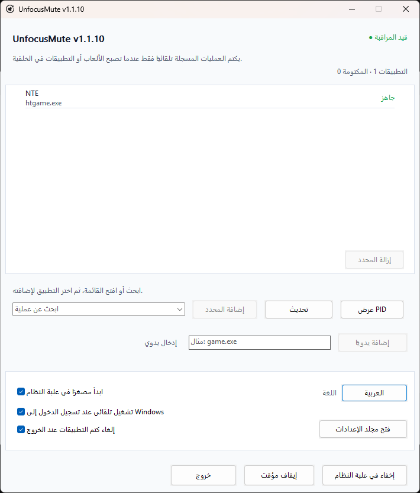

  

  <h1>UnfocusMute</h1>

  
<strong>تطبيق Windows خفيف يعمل من علبة النظام، يكتم صوت الألعاب والتطبيقات المختارة تلقائيًا عندما تفقد التركيز.</strong>

  

    <a href="../README.md">English</a> · <a href="README_ko.md">한국어</a> · <a href="README_ja.md">日本語</a> · <a href="README_zh-CN.md">简体中文</a> · <a href="README_es.md">Español</a> · <a href="README_fr.md">Français</a> · <a href="README_pt.md">Português</a> · <a href="README_hi.md">हिन्दी</a> · العربية
  

  

    
    &nbsp;
    
    &nbsp;
    
  

  
محلي بالكامل &nbsp;·&nbsp; بلا وصول إلى الشبكة &nbsp;·&nbsp; بلا قياس عن بُعد &nbsp;·&nbsp; بلا تثبيت

  

    <a href="https://github.com/ilsd7/UnfocusMute/releases/latest/download/UnfocusMute-windows-x64.zip">تنزيل</a>
    · <a href="#الاستخدام">الاستخدام</a>
    · <a href="#الأمان-والخصوصية">الخصوصية</a>
    · <a href="../LICENSE">Apache-2.0</a>
  

---

UnfocusMute هو تطبيق Windows صغير وخفيف يعمل من علبة النظام، يكتم تلقائيًا الألعاب والتطبيقات المختارة عندما تنتقل إلى الخلفية، ثم يلغي كتمها عندما تعود إلى المقدمة.

إذا لم توفر اللعبة خيارًا لكتم صوتها في الخلفية، يمكنك تركها قيد التشغيل والانتقال إلى نافذة أخرى باستخدام <kbd>Alt</kbd>+<kbd>Tab</kbd> للعمل من دون سماع صوت اللعبة. ويمكنك استخدام الميزة نفسها مع المتصفحات ومشغّلات الوسائط. تظل التطبيقات التي كتمتها يدويًا مكتومة.

كُتب التطبيق بلغة Rust ويبلغ حجم ملفه التنفيذي نحو 600 كيلوبايت.

  

---

## التنزيل والتشغيل

تعمل حزمة x64 على Windows 10 بدءًا من الإصدار 1703، وعلى Windows 11.

| أحدث حزمة |
| --- |
| [UnfocusMute-windows-x64.zip](https://github.com/ilsd7/UnfocusMute/releases/latest/download/UnfocusMute-windows-x64.zip) |
| [ملف تحقق SHA-256](https://github.com/ilsd7/UnfocusMute/releases/latest/download/UnfocusMute-windows-x64.zip.sha256) · [ملاحظات الإصدار](https://github.com/ilsd7/UnfocusMute/releases/latest) |

بعد فك الضغط، انقل مجلد <code dir="ltr">UnfocusMute-windows-x64</code> إلى المكان الذي تفضله، ثم شغّل <code dir="ltr">UnfocusMute-v&lt;version&gt;.exe</code>. لا يحتاج التطبيق إلى تثبيت أو بيئة تشغيل إضافية أو أدوات تطوير.

> **ملاحظة:** لأسباب تتعلق بالتكلفة، يُوزع UnfocusMute من دون توقيع كود لنظام Windows. لذلك قد يظهر تحذير Windows SmartScreen أو تحذير "ناشر غير معروف" عند التشغيل الأول. للتحقق بنفسك من مصدر الملف وسلامته، راجع [الشفافية والتحقق من ملفات الإصدار](#الشفافية-والتحقق-من-ملفات-الإصدار).

 

## الاستخدام

1. شغّل UnfocusMute. عند التشغيل الأول، اختر اللغة وخيارات بدء التشغيل، ثم اضغط `ابدأ`.
2. شغّل اللعبة أو التطبيق الذي تريد تسجيله، ثم شغّل أي صوت فيه كي يظهر في القائمة.
3. عُد إلى UnfocusMute، واختر التطبيق من القائمة، ثم اضغط `تسجيل`.
4. انتقل إلى نافذة أخرى باستخدام <kbd>Alt</kbd>+<kbd>Tab</kbd>. ينبغي أن ينقطع صوت التطبيق المسجّل ثم يعود عند الرجوع إليه.

> **ألا يظهر التطبيق في القائمة؟** اضغط `كل العمليات` أو أدخل اسم الملف التنفيذي الدقيق مباشرة.

### معرفة اسم الملف التنفيذي

1. شغّل اللعبة أو التطبيق الذي تريد تسجيله، ثم افتح إدارة المهام في Windows.
2. في `العمليات`، رتّب القائمة حسب استهلاك <code dir="ltr">CPU</code> من الأعلى إلى الأدنى، ثم انقر بزر الفأرة الأيمن على التطبيق المطلوب واختر `خصائص`.
3. تحقّق من اسم الملف التنفيذي كاملًا مع امتداده في نافذة الخصائص، ثم سجّل التطبيق في UnfocusMute.

### إجراءات شائعة

- انقر بزر الفأرة الأيمن على تطبيق في القائمة لإيقاف مراقبته مؤقتًا أو استئنافها، أو لإزالته من القائمة.
- إذا صعب تمييز التطبيق من اسم الملف، فاختر `تعديل الملاحظة` لإضافة وصف يظهر فوق الاسم في القائمة.
- اضغط حالة `المراقبة نشطة` في الأعلى لإيقاف المراقبة كلها مؤقتًا أو استئنافها.
- يمكنك تغيير التشغيل التلقائي وسلوك إغلاق النافذة من `الإعدادات`.
- افتراضيًا، يستمر UnfocusMute في العمل في علبة النظام عند إغلاق نافذته. للخروج بالكامل، انقر بزر الفأرة الأيمن على أيقونة علبة النظام واختر `إنهاء`.

 

## سلوكيات مهمة

**التسجيل باستخدام PID:** عند التسجيل باسم الملف التنفيذي، يشمل الكتم كل الجلسات الصوتية للعمليات التي تحمل هذا الاسم. إذا شغّلت عدة نسخ من التطبيق وأردت كتم صوت نسخة واحدة، فسجّل معرّفها وحده في `عرض PID`. وإذا كانت لها عدة جلسات صوتية، فستُكتم معًا. إذا تغيّر المعرّف بعد إعادة تشغيل التطبيق، فسجّل المعرّف الجديد.

في Windows، قد يختلف معرّف الجلسة الصوتية عن معرّف النافذة النشطة، لذا لا يكفي المعرّف وحده دائمًا لمعرفة النافذة التي يصدر منها الصوت. لهذا يعيد UnfocusMute الصوت عند الانتقال إلى أي نافذة تحمل اسم الملف التنفيذي نفسه. لا يمكنك إبقاء نسخة واحدة مكتومة أثناء استخدام نافذة أخرى من الملف التنفيذي نفسه. وعندما تعمل في تطبيق آخر، يظل بإمكانك كتم صوت العملية المسجّلة وحدها وسماع النسخ الأخرى.

**التوافق مع أنظمة مكافحة الغش:** يحدّد UnfocusMute النافذة النشطة عبر Windows ويتحكم في الصوت عبر CoreAudio. ولأنه يعمل خارج اللعبة، نتوقع أن يتوافق مع معظم أنظمة مكافحة الغش، لكن لا يمكننا ضمان التوافق مع كل لعبة.

 

## استكشاف الأخطاء وإصلاحها

- **لا أسمع صوت التطبيق:** إذا أُغلق UnfocusMute بشكل غير متوقع، فقد يظل التطبيق مكتومًا. افتح `خالط مستوى الصوت` في Windows وألغِ كتم صوت ذلك التطبيق.
- **لا يظهر التطبيق في القائمة:** شغّل صوتًا في التطبيق ثم افتح القائمة مجددًا. إذا ظل التطبيق غير ظاهر، [فابحث عن اسم ملفه التنفيذي](#معرفة-اسم-الملف-التنفيذي).
- **لا يُكتم التطبيق:** تأكد من أن الحالة في الأعلى هي `المراقبة نشطة` وأن التطبيق المسجل ليس `متوقف مؤقتًا`. قد لا تعمل الميزة أيضًا إذا قيّد برنامج تشغيل أو إعداد أذونات أو برنامج أمان الوصول إلى جلسات الصوت في Windows.
- **لا يعمل التسجيل باستخدام PID كما توقعت:** راجع [سلوك التسجيل باستخدام PID](#سلوكيات-مهمة).
- **تتغير الحالة إلى `تنبيه`:** اضغط `التفاصيل` بجوار مؤشر الحالة لعرض الخطأ.

إذا استمرت المشكلة، [فافتح بلاغًا على GitHub](https://github.com/ilsd7/UnfocusMute/issues/new/choose).

إذا كنت تشتبه في وجود ثغرة أمنية، فلا تنشر التفاصيل في بلاغ عام. استخدم عملية الإبلاغ الخاصة، وراجع [SECURITY.md](../SECURITY.md) لمزيد من المعلومات.

 

## ملف الإعدادات

إذا احتجت إلى فحص ملف الإعدادات مباشرة أو نسخه احتياطيًا، فانقر على زر `فتح مجلد الإعدادات` من شاشة الإعدادات. يفتح مستكشف الملفات مجلد <code dir="ltr">%APPDATA%\UnfocusMute</code> حيث تُحفظ الإعدادات.

يمكنك أيضًا تعديل <code dir="ltr">config.json</code> مباشرة. إذا كان تنسيقه غير صالح ولا يمكن قراءته، يحفظ UnfocusMute الملف الأصلي باسم <code dir="ltr">config.invalid-&lt;timestamp&gt;.json</code> ثم ينشئ ملف إعدادات جديدًا استنادًا إلى القيم الافتراضية أو إعدادات التطبيق الحالية.

 

## الأمان والخصوصية

UnfocusMute تطبيق يعمل محليًا بالكامل. يعمل بشكل طبيعي حتى من دون اتصال بالإنترنت، ولا يحتاج إلى صلاحيات مسؤول. كما أنه لا يرسل طلبات شبكة تلقائية، ولا يستخدم القياس عن بُعد، ولا يرسل تقارير أعطال، ولا يسجل أي شيء عن بُعد، ولا يجمع البيانات.

الاستثناء الوحيد: إذا نقرت بنفسك على زر `مستودع GitHub` في شاشة الإعدادات، يُفتح مستودع GitHub الخاص بهذا المشروع في المتصفح الافتراضي.

اكتشاف الجلسات الصوتية والتحكم في الكتم يستخدمان واجهات Windows CoreAudio فقط. لا يحقن UnfocusMute كودًا داخل العمليات المستهدفة، ولا يقرأ ذاكرتها، ولا يعترض الإدخال.

### المعلومات التي تُحفظ

يحفظ UnfocusMute فقط الإعدادات اللازمة لعمله في <code dir="ltr">%APPDATA%\UnfocusMute\config.json</code>.

- أسماء العمليات المسجلة
- معرّفات PID التي تسجلها مباشرة
- ما إذا كان UnfocusMute قد كتم صوت كل تطبيق مسجّل
- الملاحظات التي تكتبها
- اللغة والإعدادات المختارة
- موضع النافذة وحجمها

لا تُرسل هذه المعلومات إلى أي مكان.

لكن إذا فعّلت التشغيل التلقائي عند تسجيل الدخول إلى Windows، فسيُحفظ مسار الملف التنفيذي الحالي أيضًا في قيمة `UnfocusMute` ضمن <code dir="ltr">HKEY_CURRENT_USER\Software\Microsoft\Windows\CurrentVersion\Run</code>.

### المعلومات التي لا تُحفظ

لا يحفظ UnfocusMute سجل الاستخدام، أو سجلات النشاط، أو سجلات الأخطاء، أو بيانات الصوت، أو عناوين النوافذ، أو ضغطات المفاتيح، أو أي معلومات غير مذكورة أعلاه ضمن «المعلومات التي تُحفظ».

### إزالة UnfocusMute بالكامل

1. إذا فعّلت `التشغيل تلقائيًا مع Windows`، فأوقفه أولًا من `الإعدادات`.
2. انقر بزر الفأرة الأيمن على أيقونة علبة النظام واختر `إنهاء`.
3. احذف مجلدي <code dir="ltr">UnfocusMute-windows-x64</code> و<code dir="ltr">%APPDATA%\UnfocusMute</code>.

إذا حذفت الملف التنفيذي بالفعل ولم يعد بإمكانك إيقاف التشغيل التلقائي، فاحذف قيمة `UnfocusMute` من <code dir="ltr">HKEY_CURRENT_USER\Software\Microsoft\Windows\CurrentVersion\Run</code>.

 

## الشفافية والتحقق من ملفات الإصدار

صُمم UnfocusMute ليُستخدم بأمان في البيئات المعتادة، لذلك لا يحتاج معظم المستخدمين إلى تنفيذ خطوات التحقق أدناه بشكل منفصل. إذا كنت لا تريد الاعتماد على الثقة بالمطور وحدها أو كنت تولي أمن سلسلة توريد البرمجيات أهمية خاصة، فيمكنك استخدام هذه الخطوات المنشورة للتحقق من مصدر الملفات التي نزّلتها وسلامتها.

### لماذا يلزم تحقق منفصل

حتى لو راجعت الكود المصدري للمستودع بنفسك ووجدته آمنًا، فلا يمكنك الجزم بأن الملفات المنشورة في إصدار GitHub قد بُنيت فعلًا من ذلك المصدر. فإذا تم اختراق حساب المطور أو أسيء استخدام صلاحيات نشر الإصدارات، فقد تُوزع ملفات لا علاقة لها بالكود المصدري المنشور.

يمكن لمقارنة تجزئات SHA-256 تأكيد مطابقة الملف المنزّل لملف التحقق المنشور، لكنها لا تثبت الكود المصدري وبيئة البناء اللذين أُنشئ منهما الملف.

وللتعامل بشفافية مع مخاطر سلسلة التوريد هذه، يوضّح UnfocusMute كيفية التحقق مباشرة من أن ملف إصدار GitHub هو ناتج بناء رسمي أنشأته GitHub Actions من نسخة المصدر التي يشير إليها وسم ذلك الإصدار.

عرض خطوات التحقق من ملفات الإصدار

ثبّت [GitHub CLI](https://cli.github.com/)، ثم افتح PowerShell في المجلد الذي نزّلت فيه ملف ZIP. إذا أردت أيضًا مقارنة قيم التحقق، فاحفظ ملف <code dir="ltr">.sha256</code> من الإصدار نفسه في ذلك المجلد. استبدل قيمة <code dir="ltr">$version</code> بوسم الإصدار الذي تريد التحقق منه، ثم نفّذ الأوامر أدناه.

<pre dir="ltr"><code>$version = "v1.5.0"
$sourceRef = "refs/tags/$version"
$workflow = "ilsd7/UnfocusMute/.github/workflows/release.yml"

gh attestation verify .\UnfocusMute-windows-x64.zip `
  -R ilsd7/UnfocusMute `
  --source-ref $sourceRef `
  --signer-workflow $workflow</code></pre>

يتصل هذا الأمر بخدمة attestations في GitHub ويتحقق من أن تجزئة SHA-256 لملف ZIP المحلي تطابق القيمة المسجلة في إثبات منشأ البناء الموقّع من GitHub Actions.

ويمكنك أيضًا مطابقة تجزئة ملف ZIP مع قيمة SHA-256 المنشورة ضمن الإصدار.

<pre dir="ltr"><code>$expectedHash = ((Get-Content .\UnfocusMute-windows-x64.zip.sha256 -TotalCount 1) -split '\s+')[0]
$actualHash = (Get-FileHash .\UnfocusMute-windows-x64.zip -Algorithm SHA256).Hash

if ($actualHash -ne $expectedHash) {
  throw "فشل التحقق من SHA-256."
}

"تم التحقق من SHA-256: $actualHash"</code></pre>

عند نجاح التحقق، يمكنك التأكد من أن ملف ZIP الذي نزّلته أنشأه سير عمل GitHub Actions المحدد من المصدر المرتبط بوسم الإصدار، وأن تجزئته تطابق القيمة المسجلة في attestation.

لكن هذا لا يثبت سلامة الكود المصدري نفسه، ولا سلامة بيئة GitHub بأكملها، ولا أن البناء قابل لإعادة الإنتاج بايتًا ببايت على جهاز آخر.

 

## البناء من المصدر

هدف الإصدار الموصى به هو <code dir="ltr">x86_64-pc-windows-msvc</code>.

الأدوات المطلوبة:

- Rust stable
- Visual Studio Build Tools 2022 أو Visual Studio 2022
- Windows 10/11 SDK

ستحتاج أيضًا إلى <code dir="ltr">cargo-about</code> عند تحديث <code dir="ltr">THIRD_PARTY_NOTICES.md</code>.

عرض أوامر البناء وإنشاء الحزمة

<pre dir="ltr"><code>rustup target add x86_64-pc-windows-msvc
cargo build --release --target x86_64-pc-windows-msvc --locked</code></pre>

إعدادات بناء الإصدار مضبوطة لتقليل حجم الملف الناتج. يزيل ملف تعريف الإصدار في <code dir="ltr">Cargo.toml</code> الرموز، ويفعّل LTO، ويستخدم وحدة توليد كود واحدة (codegen unit)، ويضبط <code dir="ltr">panic = "abort"</code>، ويستخدم تحسينات موجهة لتقليل الحجم.

الملف التنفيذي:

<pre dir="ltr"><code>target\x86_64-pc-windows-msvc\release\unfocusmute.exe</code></pre>

ملف ZIP للتوزيع:

<pre dir="ltr"><code>powershell -NoProfile -ExecutionPolicy Bypass -File scripts\package-windows.ps1</code></pre>

عند الحاجة إلى تحديث إشعارات تراخيص الطرف الثالث:

<pre dir="ltr"><code>cargo about generate about.hbs -c about.toml --locked --offline -o THIRD_PARTY_NOTICES.md</code></pre>

يتم إنشاء الناتج في <code dir="ltr">dist\UnfocusMute-windows-x64.zip</code>، ومعه ملف تحقق SHA-256 في <code dir="ltr">dist\UnfocusMute-windows-x64.zip.sha256</code>. يحتوي ZIP على الملف التنفيذي الذي يتضمن رقم الإصدار (<code dir="ltr">UnfocusMute-v&lt;version&gt;.exe</code>)، و<code dir="ltr">LICENSE</code>، و<code dir="ltr">THIRD_PARTY_NOTICES.md</code>.

 

## الترخيص

Apache License 2.0. راجع [LICENSE](../LICENSE) للتفاصيل.

راجع [THIRD_PARTY_NOTICES.md](../THIRD_PARTY_NOTICES.md) لإشعارات تراخيص حزم Rust الخارجية.

