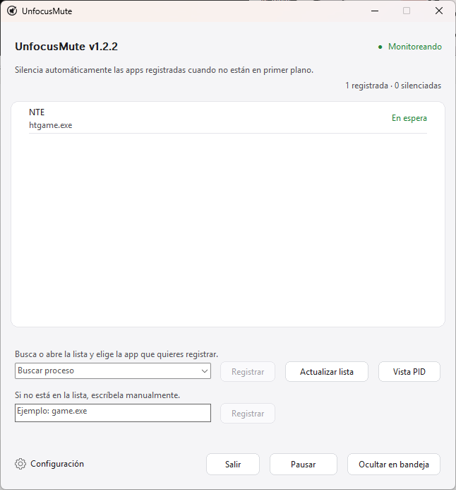

<div align="center">
  

  <h1>UnfocusMute</h1>

  <p><strong>Aplicación ligera que se ejecuta en la bandeja del sistema de Windows y silencia automáticamente juegos y aplicaciones seleccionados cuando pierden el foco.</strong></p>

  <p>
    <a href="../README.md">English</a> · <a href="README_ko.md">한국어</a> · <a href="README_ja.md">日本語</a> · <a href="README_zh-CN.md">简体中文</a> · Español · <a href="README_fr.md">Français</a> · <a href="README_pt.md">Português</a> · <a href="README_hi.md">हिन्दी</a> · <a href="README_ar.md">العربية</a>
  </p>

  <p>
    <a href="https://github.com/ilsd7/UnfocusMute/actions/workflows/ci.yml"></a>
    &nbsp;
    
    &nbsp;
    <a href="../LICENSE"></a>
  </p>

  <p>Totalmente local &nbsp;·&nbsp; Sin acceso a la red &nbsp;·&nbsp; Sin telemetría &nbsp;·&nbsp; No requiere instalación</p>

  <p>
    <a href="https://github.com/ilsd7/UnfocusMute/releases/latest/download/UnfocusMute-windows-x64.zip">Descargar</a>
    · <a href="#uso">Uso</a>
    · <a href="#seguridad-y-privacidad">Privacidad</a>
    · <a href="../LICENSE">Apache-2.0</a>
  </p>
</div>

---

UnfocusMute es una aplicación pequeña y ligera para la bandeja del sistema de Windows que silencia automáticamente los juegos y las aplicaciones que elijas cuando pasan a segundo plano y reactiva su sonido cuando vuelven al primer plano.

Si un juego no tiene opción de silenciarse en segundo plano, puedes dejarlo abierto y usar `Alt`+`Tab` para trabajar en otra ventana sin oír el juego. También puedes usar esta función con navegadores y reproductores multimedia. Las aplicaciones que silencies manualmente seguirán en silencio.

El ejecutable nativo, escrito en Rust, ocupa unos 600 KB.

<p align="center">
  
</p>

---

## Descargar y ejecutar

La descarga para x64 es compatible con Windows 10 a partir de la versión 1703 y con Windows 11.

| Paquete más reciente |
| --- |
| [UnfocusMute-windows-x64.zip](https://github.com/ilsd7/UnfocusMute/releases/latest/download/UnfocusMute-windows-x64.zip) |
| [Suma de comprobación SHA-256](https://github.com/ilsd7/UnfocusMute/releases/latest/download/UnfocusMute-windows-x64.zip.sha256) · [Notas de la versión](https://github.com/ilsd7/UnfocusMute/releases/latest) |

Después de extraer el ZIP, mueve la carpeta `UnfocusMute-windows-x64` a la ubicación que prefieras y ejecuta `UnfocusMute-v<version>.exe`. No requiere instalación, un entorno de ejecución adicional ni herramientas de desarrollo.

> **Nota:** Por motivos de costo, UnfocusMute se distribuye sin firma de código de Windows. Por eso, la primera vez que lo ejecutes puede aparecer una advertencia de SmartScreen o de "editor desconocido". Para comprobar por tu cuenta el origen y la integridad del archivo, consulta [Transparencia y verificación de archivos de la versión](#transparencia-y-verificación-de-archivos-de-la-versión).

<br>

## Uso

1. Abre UnfocusMute. La primera vez, elige el idioma y las opciones de inicio, y haz clic en `Comenzar`.
2. Abre el juego o la aplicación que quieras registrar y reproduce algún sonido para que aparezca en la lista.
3. Vuelve a UnfocusMute, selecciona la aplicación y haz clic en `Registrar`.
4. Cambia de ventana con `Alt`+`Tab`. La aplicación debería silenciarse y recuperar el sonido cuando vuelvas a ella.

> **¿La aplicación no aparece en la lista?** Haz clic en `Todos los procesos` o escribe directamente el nombre exacto del ejecutable.

### Encontrar el nombre del ejecutable

1. Abre el juego o la aplicación que quieras registrar y luego abre el Administrador de tareas de Windows.
2. En `Procesos`, ordena la lista por uso de `CPU` de mayor a menor, haz clic con el botón derecho en la aplicación y selecciona `Propiedades`.
3. Comprueba el nombre del ejecutable en la ventana de propiedades, incluida la extensión, y registra la aplicación en UnfocusMute.

### Acciones habituales

- Haz clic con el botón derecho en una aplicación de la lista para pausar o reanudar su supervisión, o para quitarla de la lista.
- Si cuesta reconocer el nombre de un archivo, usa `Editar nota` para añadir una descripción encima del nombre en la lista.
- Haz clic en el estado `Supervisando` de la parte superior para pausar o reanudar toda la supervisión.
- En `Configuración` puedes cambiar el inicio automático y lo que ocurre al cerrar la ventana.
- De forma predeterminada, UnfocusMute sigue en la bandeja del sistema al cerrar la ventana. Para salir por completo, haz clic con el botón derecho en el icono de la bandeja y selecciona `Salir`.

<br>

## Comportamientos importantes

**Registro por PID:** Al registrar un ejecutable por nombre, se silencian en segundo plano todas las sesiones de audio de los procesos con ese nombre. Si tienes varias instancias abiertas y solo quieres silenciar una, registra únicamente su PID en `Vista PID`. Todas las sesiones de audio de ese PID se silencian juntas. Si cambia el PID al reiniciar la aplicación, registra el nuevo.

En Windows, la sesión de audio y la ventana en primer plano pueden tener PID distintos, por lo que el PID por sí solo no siempre permite saber de qué ventana procede el sonido. Por eso, UnfocusMute reactiva el sonido al cambiar a cualquier ventana con el mismo nombre de ejecutable. No puedes mantener una instancia silenciada mientras usas otra ventana de ese ejecutable. Cuando trabajas en otra aplicación, sí puedes silenciar solo el PID registrado y seguir oyendo las demás instancias.

**Compatibilidad con sistemas antitrampas:** UnfocusMute consulta en Windows qué ventana está en primer plano y controla el sonido mediante CoreAudio. Al funcionar fuera del juego, esperamos que sea compatible con la mayoría de los sistemas antitrampas, aunque no podemos garantizar la compatibilidad con todos los juegos.

<br>

## Solución de problemas

- **No se oye la aplicación:** Si UnfocusMute se cierra de forma inesperada, la aplicación puede quedar silenciada. Abre el `Mezclador de volumen` de Windows y reactiva el sonido de esa aplicación.
- **La aplicación no aparece en la lista:** Reproduce algún sonido en la aplicación y vuelve a abrir la lista. Si sigue sin aparecer, [busca el nombre del ejecutable](#encontrar-el-nombre-del-ejecutable).
- **No se silencia:** Comprueba que el estado superior sea `Supervisando` y que la aplicación registrada no esté `En pausa`. También puede fallar si un controlador, la configuración de permisos o un programa de seguridad limita el acceso a las sesiones de audio de Windows.
- **El registro por PID no funciona como esperabas:** Consulta el [comportamiento del registro por PID](#comportamientos-importantes).
- **El estado cambia a `Requiere atención`:** Haz clic en `Detalles`, junto al indicador de estado, para ver el error.

Si el problema continúa, [abre una incidencia en GitHub](https://github.com/ilsd7/UnfocusMute/issues/new/choose).

Si sospechas que el problema es una vulnerabilidad de seguridad, no publiques los detalles en una incidencia pública. Usa el proceso de notificación privada y consulta [SECURITY.md](../SECURITY.md) para más información.

<br>

## Archivo de configuración

Si necesitas revisar directamente el archivo de configuración o hacer una copia de seguridad, haz clic en `Abrir carpeta de configuración` en Configuración. Se abrirá el Explorador de archivos en la carpeta `%APPDATA%\UnfocusMute`, donde se guarda la configuración.

También puedes editar `config.json` directamente. Si el formato no es válido y no se puede leer, UnfocusMute guarda una copia del archivo original como `config.invalid-<timestamp>.json` y crea uno nuevo a partir de los valores predeterminados o de la configuración actual de la aplicación.

<br>

## Seguridad y privacidad

UnfocusMute se ejecuta de forma completamente local. Funciona con normalidad aunque no tengas conexión a internet y no requiere permisos de administrador. Tampoco realiza solicitudes de red automáticas, ni usa telemetría, ni envía informes de fallos ni registros a servicios remotos, ni recopila datos.

Como excepción, el repositorio de GitHub del proyecto solo se abre en tu navegador predeterminado cuando pulsas el botón `GitHub` en Configuración.

La detección de sesiones de audio y el control de silencio solo usan las API CoreAudio de Windows. UnfocusMute no inyecta código en los procesos de destino, no lee su memoria ni intercepta la entrada del usuario.

### Información que guarda

UnfocusMute solo guarda en `%APPDATA%\UnfocusMute\config.json` la configuración necesaria para funcionar.

- Nombres de procesos registrados
- PID registrados directamente
- Qué aplicaciones registradas ha silenciado UnfocusMute
- Notas que escribas
- Idioma y configuración elegidos
- Posición y tamaño de la ventana

Esta información no se envía a ningún sitio.

Si activas el inicio automático al iniciar sesión en Windows, la ruta del ejecutable actual también se guarda en el valor `UnfocusMute` de `HKEY_CURRENT_USER\Software\Microsoft\Windows\CurrentVersion\Run`.

### Información que no guarda

UnfocusMute no guarda historial de uso, registros de actividad, registros de errores, datos de audio, títulos de ventanas, pulsaciones de teclas ni ninguna información que no aparezca arriba en "Información que guarda".

### Eliminar UnfocusMute por completo

1. Si activaste `Ejecutar al iniciar sesión en Windows`, desactívalo primero desde `Configuración`.
2. Haz clic con el botón derecho en el icono de la bandeja y selecciona `Salir`.
3. Elimina la carpeta `UnfocusMute-windows-x64` y la carpeta `%APPDATA%\UnfocusMute`.

Si ya eliminaste el ejecutable y no puedes desactivar el inicio automático, elimina el valor `UnfocusMute` de `HKEY_CURRENT_USER\Software\Microsoft\Windows\CurrentVersion\Run`.

<br>

## Transparencia y verificación de archivos de la versión

UnfocusMute está diseñado para usarse de forma segura en entornos habituales, por lo que la mayoría de los usuarios no necesitan realizar los pasos de verificación que se indican a continuación. Si no quieres depender únicamente de la confianza en el desarrollador o das especial importancia a la seguridad de la cadena de suministro de software, puedes usar este procedimiento público para verificar el origen y la integridad de los archivos descargados.

### Por qué se necesita una verificación independiente

Aunque revises el código fuente del repositorio y determines que es seguro, no puedes dar por hecho que los archivos de una versión publicada en GitHub se crearon realmente a partir de ese código. Si se compromete la cuenta del desarrollador o se abusa de los permisos de publicación, podrían distribuirse archivos ajenos al código fuente publicado.

La comparación de hashes SHA-256 permite confirmar que un archivo descargado coincide con la suma de comprobación publicada, pero no demuestra qué código fuente y entorno de compilación lo generaron.

Para abordar de forma transparente estos riesgos de la cadena de suministro, UnfocusMute publica un método que permite verificar directamente que un archivo de una versión publicada en GitHub es un artefacto oficial generado por GitHub Actions a partir del commit al que apunta la etiqueta de esa versión.

<details>
<summary>Mostrar los pasos de verificación</summary>

Instala [GitHub CLI](https://cli.github.com/) y abre PowerShell en la carpeta donde descargaste el ZIP. Si también quieres comparar las sumas de comprobación, guarda en esa carpeta el archivo `.sha256` de la misma versión. Sustituye el valor de `$version` por la etiqueta de la versión que quieras verificar y ejecuta los siguientes comandos.

```powershell
$version = "v1.5.0"
$sourceRef = "refs/tags/$version"
$workflow = "ilsd7/UnfocusMute/.github/workflows/release.yml"

gh attestation verify .\UnfocusMute-windows-x64.zip `
  -R ilsd7/UnfocusMute `
  --source-ref $sourceRef `
  --signer-workflow $workflow
```

Este comando se conecta al servicio de atestación de GitHub y comprueba que el SHA-256 del ZIP local coincide con el valor registrado en la procedencia de compilación firmada por GitHub Actions.

También puedes comparar el ZIP con el hash SHA-256 publicado en la versión.

```powershell
$expectedHash = ((Get-Content .\UnfocusMute-windows-x64.zip.sha256 -TotalCount 1) -split '\s+')[0]
$actualHash = (Get-FileHash .\UnfocusMute-windows-x64.zip -Algorithm SHA256).Hash

if ($actualHash -ne $expectedHash) {
  throw "La verificación SHA-256 ha fallado."
}

"SHA-256 verificado: $actualHash"
```

Si la verificación se completa correctamente, puedes confirmar que el ZIP descargado fue generado por el flujo de trabajo de GitHub Actions indicado para la etiqueta de versión especificada y que coincide con el hash registrado en su atestación.

Esto no demuestra que el código fuente sea seguro, que todo el entorno de GitHub esté intacto ni que la compilación pueda reproducirse byte por byte en otro equipo.

</details>

<br>

## Compilar desde el código fuente

El objetivo recomendado para las versiones publicadas es `x86_64-pc-windows-msvc`.

Herramientas necesarias:

- Rust stable
- Visual Studio Build Tools 2022 o Visual Studio 2022
- Windows 10/11 SDK

También necesitas `cargo-about` si quieres actualizar `THIRD_PARTY_NOTICES.md`.

<details>
<summary>Mostrar comandos de compilación y empaquetado</summary>

```powershell
rustup target add x86_64-pc-windows-msvc
cargo build --release --target x86_64-pc-windows-msvc --locked
```

La compilación en modo release está configurada para reducir el tamaño del binario. El perfil de release de `Cargo.toml` elimina símbolos, activa LTO, usa una sola unidad de generación de código (codegen unit), establece `panic = "abort"` y optimiza por tamaño.

Ejecutable:

```text
target\x86_64-pc-windows-msvc\release\unfocusmute.exe
```

ZIP de distribución:

```powershell
powershell -NoProfile -ExecutionPolicy Bypass -File scripts\package-windows.ps1
```

Cuando necesites actualizar los avisos de licencias de terceros:

```powershell
cargo about generate about.hbs -c about.toml --locked --offline -o THIRD_PARTY_NOTICES.md
```

El resultado se crea en `dist\UnfocusMute-windows-x64.zip`, junto con el archivo de verificación SHA-256 `dist\UnfocusMute-windows-x64.zip.sha256`. El ZIP incluye el ejecutable con versión (`UnfocusMute-v<version>.exe`), `LICENSE` y `THIRD_PARTY_NOTICES.md`.

</details>

<br>

## Licencia

Apache License 2.0. Consulta [LICENSE](../LICENSE) para más detalles.

Consulta [THIRD_PARTY_NOTICES.md](../THIRD_PARTY_NOTICES.md) para los avisos de licencias de crates de Rust de terceros.
