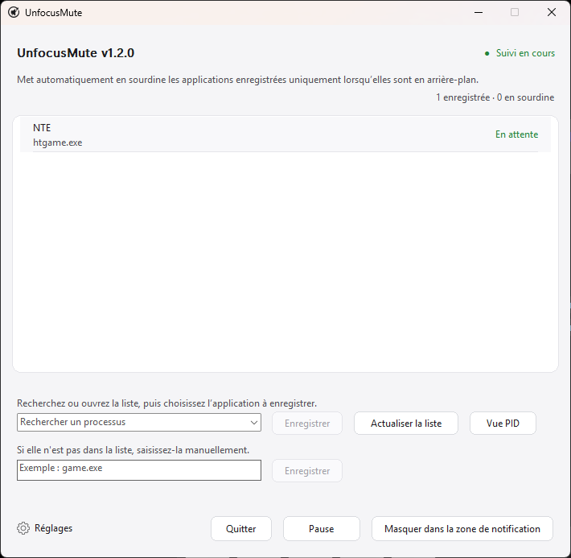

<div align="center">
  

  <h1>UnfocusMute</h1>

  <p><strong>Application légère qui s’exécute dans la zone de notification de Windows et coupe automatiquement le son des jeux et applications choisis lorsqu’ils ne sont plus au premier plan.</strong></p>

  <p>
    <a href="../README.md">English</a> · <a href="README_ko.md">한국어</a> · <a href="README_ja.md">日本語</a> · <a href="README_zh-CN.md">简体中文</a> · <a href="README_es.md">Español</a> · Français · <a href="README_pt.md">Português</a> · <a href="README_hi.md">हिन्दी</a> · <a href="README_ar.md">العربية</a>
  </p>

  <p>
    <a href="https://github.com/ilsd7/UnfocusMute/actions/workflows/ci.yml"></a>
    &nbsp;
    
    &nbsp;
    <a href="../LICENSE"></a>
  </p>

  <p>Fonctionnement 100 % local &nbsp;·&nbsp; Aucun accès réseau &nbsp;·&nbsp; Aucune télémétrie &nbsp;·&nbsp; Aucune installation requise</p>

  <p>
    <a href="https://github.com/ilsd7/UnfocusMute/releases/latest/download/UnfocusMute-windows-x64.zip">Télécharger</a>
    · <a href="#utilisation">Utilisation</a>
    · <a href="#sécurité-et-confidentialité">Confidentialité</a>
    · <a href="../LICENSE">Apache-2.0</a>
  </p>
</div>

---

UnfocusMute est une petite application Windows légère qui s’exécute dans la zone de notification, coupe automatiquement le son des jeux et applications choisis lorsqu’ils passent en arrière-plan, puis le réactive lorsqu’ils reviennent au premier plan.

Si un jeu ne permet pas de couper le son en arrière-plan, vous pouvez le laisser ouvert et passer à une autre fenêtre avec `Alt`+`Tab` pour travailler au calme. Cette fonction s’applique aussi aux navigateurs et aux lecteurs multimédias. Les applications que vous avez mises en sourdine le restent.

L’exécutable natif, écrit en Rust, pèse environ 600 Ko.

<p align="center">
  
</p>

---

## Télécharger et lancer

La version x64 fonctionne sous Windows 10 à partir de la version 1703, ainsi que sous Windows 11.

| Dernière archive publiée |
| --- |
| [UnfocusMute-windows-x64.zip](https://github.com/ilsd7/UnfocusMute/releases/latest/download/UnfocusMute-windows-x64.zip) |
| [Somme de contrôle SHA-256](https://github.com/ilsd7/UnfocusMute/releases/latest/download/UnfocusMute-windows-x64.zip.sha256) · [Notes de version](https://github.com/ilsd7/UnfocusMute/releases/latest) |

Une fois le ZIP extrait, déplacez le dossier `UnfocusMute-windows-x64` à l’emplacement de votre choix, puis lancez `UnfocusMute-v<version>.exe`. Aucune installation, aucun environnement d’exécution supplémentaire ni aucun outil de développement n’est nécessaire.

> **Remarque :** Pour des raisons de coût, UnfocusMute est distribué sans signature de code Windows. Un avertissement Windows SmartScreen ou « éditeur inconnu » peut donc s’afficher au premier lancement. Pour vérifier vous-même l’origine et l’intégrité du fichier, consultez [Transparence et vérification des fichiers publiés](#transparence-et-vérification-des-fichiers-publiés).

<br>

## Utilisation

1. Lancez UnfocusMute. Au premier démarrage, choisissez la langue et les options de lancement, puis cliquez sur `Commencer`.
2. Lancez le jeu ou l’application à ajouter et faites-lui produire un son pour qu’il apparaisse dans la liste.
3. Revenez dans UnfocusMute, sélectionnez l’application, puis cliquez sur `Ajouter`.
4. Passez à une autre fenêtre avec `Alt`+`Tab`. Le son de l’application devrait se couper, puis revenir lorsque vous repassez sur celle-ci.

> **L’application n’apparaît pas dans la liste ?** Cliquez sur `Tous les processus` ou saisissez directement le nom exact du fichier exécutable.

### Trouver le nom de l’exécutable

1. Lancez le jeu ou l’application à ajouter, puis ouvrez le Gestionnaire des tâches de Windows.
2. Dans `Processus`, triez les applications par utilisation décroissante du `Processeur`, puis faites un clic droit sur l’application voulue et choisissez `Propriétés`.
3. Repérez le nom de l’exécutable dans la fenêtre des propriétés, extension comprise, puis ajoutez l’application dans UnfocusMute.

### Actions courantes

- Faites un clic droit sur une application de la liste pour suspendre ou reprendre sa surveillance, ou pour la retirer de la liste.
- Si un nom de fichier est difficile à reconnaître, choisissez `Modifier la note` pour afficher une description au-dessus du nom dans la liste.
- Cliquez sur l’état `Surveillance en cours` en haut pour suspendre ou reprendre toute la surveillance.
- Dans `Paramètres`, vous pouvez modifier le démarrage automatique et le comportement à la fermeture de la fenêtre.
- Par défaut, UnfocusMute reste actif dans la zone de notification quand vous fermez sa fenêtre. Pour quitter complètement l’application, faites un clic droit sur l’icône de la zone de notification, puis sélectionnez `Quitter`.

<br>

## Comportements à connaître

**Ajout par PID :** L’ajout par nom d’exécutable cible toutes les sessions audio des processus portant ce nom. Si plusieurs instances sont ouvertes et que vous souhaitez en mettre une seule en sourdine, ajoutez uniquement son PID dans la `Vue PID`. Toutes les sessions audio de ce PID sont mises en sourdine ensemble. Si le PID change au redémarrage de l’application, ajoutez le nouveau.

Sous Windows, la session audio et la fenêtre au premier plan peuvent avoir des PID différents. Le PID seul ne permet donc pas toujours d’identifier la fenêtre à laquelle le son est associé. C’est pourquoi UnfocusMute rétablit le son dès que vous activez une fenêtre portant le même nom d’exécutable. Vous ne pouvez pas garder une instance en sourdine pendant que vous utilisez une autre fenêtre du même exécutable. Lorsque vous travaillez dans une autre application, vous pouvez couper uniquement le son de l’instance enregistrée et continuer à entendre les autres instances.

**Compatibilité anti-triche :** UnfocusMute interroge Windows pour identifier la fenêtre au premier plan et contrôle le son via CoreAudio. Comme il fonctionne en dehors du jeu, nous nous attendons à ce qu’il soit compatible avec la plupart des systèmes anti-triche, sans pouvoir le garantir pour tous les jeux.

<br>

## Dépannage

- **Aucun son dans l’application :** Si UnfocusMute se ferme de manière inattendue, l’application peut rester en sourdine. Ouvrez le `Mélangeur de volume` de Windows et rétablissez le son de cette application.
- **L’application n’apparaît pas dans la liste :** Faites jouer un son dans l’application, puis rouvrez la liste. Si elle reste introuvable, [recherchez le nom de son exécutable](#trouver-le-nom-de-lexécutable).
- **Le son n’est pas coupé :** Vérifiez que l’état en haut indique `Surveillance en cours` et que l’application ajoutée n’est pas `En pause`. Le fonctionnement peut aussi être perturbé si un pilote, un réglage d’autorisation ou un logiciel de sécurité limite l’accès aux sessions audio de Windows.
- **L’ajout par PID ne fonctionne pas comme prévu :** Consultez le [comportement de l’ajout par PID](#comportements-à-connaître).
- **L’état passe à `Attention requise` :** Cliquez sur `Détails`, à côté de l’indicateur d’état, pour consulter l’erreur.

Si le problème persiste, [ouvrez une issue sur GitHub](https://github.com/ilsd7/UnfocusMute/issues/new/choose).

Si vous pensez qu’il s’agit d’une faille de sécurité, ne publiez pas les détails dans une issue publique. Utilisez la procédure de signalement privé et consultez [SECURITY.md](../SECURITY.md) pour plus d’informations.

<br>

## Fichier de configuration

Pour consulter ou sauvegarder directement le fichier de configuration, cliquez sur `Ouvrir le dossier des paramètres` dans Paramètres. L’Explorateur de fichiers ouvre le dossier `%APPDATA%\UnfocusMute`, où les paramètres sont enregistrés.

Vous pouvez également modifier directement `config.json`. Si son format est invalide et ne peut pas être lu, UnfocusMute sauvegarde le fichier d’origine sous `config.invalid-<timestamp>.json`, puis en crée un nouveau à partir des valeurs par défaut ou des réglages actuels de l’application.

<br>

## Sécurité et confidentialité

UnfocusMute s’exécute entièrement en local. L’application fonctionne normalement même sans connexion Internet et ne demande pas de droits administrateur. Elle n’effectue pas non plus de requêtes réseau automatiques, n’utilise pas de télémétrie, n’envoie pas de rapports de plantage, n’effectue aucune journalisation distante et ne collecte pas de données.

La seule exception est le bouton `Dépôt GitHub` dans les paramètres : il ouvre le dépôt GitHub du projet dans votre navigateur par défaut uniquement lorsque vous cliquez dessus.

La détection des sessions audio et le contrôle du son utilisent uniquement les API Windows CoreAudio. UnfocusMute n’injecte pas de code dans les processus ciblés, ne lit pas leur mémoire et n’intercepte pas les entrées.

### Informations stockées

UnfocusMute stocke uniquement les réglages nécessaires à son fonctionnement dans `%APPDATA%\UnfocusMute\config.json`.

- Noms de processus ajoutés
- PID ajoutés directement
- Les applications qu’UnfocusMute a mises en sourdine parmi celles que vous avez ajoutées
- Notes saisies
- Langue et paramètres choisis
- Position et taille de la fenêtre

Ces informations ne sont envoyées nulle part.

Si vous activez le démarrage automatique à l’ouverture de session Windows, le chemin de l’exécutable actuel est aussi enregistré dans la valeur `UnfocusMute` sous `HKEY_CURRENT_USER\Software\Microsoft\Windows\CurrentVersion\Run`.

### Informations non stockées

UnfocusMute ne stocke pas l’historique d’utilisation, les journaux d’activité, les journaux d’erreurs, les données audio, les titres de fenêtres, les frappes au clavier ni aucune autre information que celles indiquées ci-dessus dans « Informations stockées ».

### Supprimer complètement UnfocusMute

1. Si vous avez activé `Lancer à l’ouverture de session Windows`, désactivez d’abord cette option dans `Paramètres`.
2. Faites un clic droit sur l’icône de la zone de notification, puis sélectionnez `Quitter`.
3. Supprimez les dossiers `UnfocusMute-windows-x64` et `%APPDATA%\UnfocusMute`.

Si vous avez déjà supprimé l’exécutable et ne pouvez plus désactiver le démarrage automatique, supprimez la valeur `UnfocusMute` sous `HKEY_CURRENT_USER\Software\Microsoft\Windows\CurrentVersion\Run`.

<br>

## Transparence et vérification des fichiers publiés

UnfocusMute est conçu pour être utilisé en toute sécurité dans les environnements courants. La plupart des utilisateurs n’ont donc pas besoin de suivre les étapes de vérification ci-dessous. Si vous ne souhaitez pas dépendre uniquement de la confiance accordée au développeur ou si vous accordez une importance particulière à la sécurité de la chaîne d’approvisionnement logicielle, vous pouvez suivre cette procédure publique pour vérifier l’origine et l’intégrité des fichiers téléchargés.

### Pourquoi une vérification distincte est nécessaire

Même après avoir examiné le code source du dépôt et l’avoir jugé sûr, vous ne pouvez pas conclure que les fichiers d’une version publiée sur GitHub ont effectivement été produits à partir de ce code. Si le compte du développeur est compromis ou si les droits de publication sont détournés, des fichiers sans rapport avec le code source publié pourraient être distribués.

La comparaison des hachages SHA-256 permet de confirmer qu’un fichier téléchargé correspond à la somme de contrôle publiée, mais elle ne prouve pas à partir de quel code source ni dans quel environnement de compilation il a été produit.

Afin de traiter ces risques de chaîne d’approvisionnement de façon transparente, UnfocusMute publie une méthode permettant de vérifier directement qu’un fichier joint à une version publiée sur GitHub est un artefact officiel généré par GitHub Actions à partir du commit référencé par le tag de cette version.

<details>
<summary>Afficher la procédure de vérification</summary>

Installez [GitHub CLI](https://cli.github.com/), puis ouvrez PowerShell dans le dossier où vous avez téléchargé le ZIP. Pour comparer aussi les sommes de contrôle, enregistrez le fichier `.sha256` de la même version dans ce dossier. Remplacez la valeur de `$version` par le tag de la version à vérifier, puis exécutez les commandes ci-dessous.

```powershell
$version = "v1.5.0"
$sourceRef = "refs/tags/$version"
$workflow = "ilsd7/UnfocusMute/.github/workflows/release.yml"

gh attestation verify .\UnfocusMute-windows-x64.zip `
  -R ilsd7/UnfocusMute `
  --source-ref $sourceRef `
  --signer-workflow $workflow
```

Cette commande contacte le service d’attestation de GitHub et vérifie que le SHA-256 du ZIP local correspond à la valeur enregistrée dans la provenance de compilation signée par GitHub Actions.

Vous pouvez également comparer le ZIP au hachage SHA-256 publié avec la version.

```powershell
$expectedHash = ((Get-Content .\UnfocusMute-windows-x64.zip.sha256 -TotalCount 1) -split '\s+')[0]
$actualHash = (Get-FileHash .\UnfocusMute-windows-x64.zip -Algorithm SHA256).Hash

if ($actualHash -ne $expectedHash) {
  throw "La vérification SHA-256 a échoué."
}

"SHA-256 vérifié : $actualHash"
```

Une vérification réussie confirme que le ZIP téléchargé a été généré par le workflow GitHub Actions indiqué pour le tag de version spécifié et qu’il correspond au hachage enregistré dans son attestation.

Elle ne prouve pas que le code source lui-même est sûr, que l’ensemble de l’environnement GitHub est intact, ni que la compilation est reproductible octet par octet sur un autre ordinateur.

</details>

<br>

## Compiler depuis le code source

La cible recommandée pour les versions publiées est `x86_64-pc-windows-msvc`.

Outils nécessaires :

- Rust stable
- Visual Studio Build Tools 2022 ou Visual Studio 2022
- SDK Windows 10/11

`cargo-about` est également nécessaire pour mettre à jour `THIRD_PARTY_NOTICES.md`.

<details>
<summary>Afficher les commandes de compilation et de création du paquet</summary>

```powershell
rustup target add x86_64-pc-windows-msvc
cargo build --release --target x86_64-pc-windows-msvc --locked
```

Les compilations destinées aux versions publiées sont configurées pour réduire la taille du binaire. Le profil `release` de `Cargo.toml` retire les symboles, active LTO, utilise une seule unité de génération de code (`codegen-units = 1`), définit `panic = "abort"` et optimise pour la taille.

Exécutable :

```text
target\x86_64-pc-windows-msvc\release\unfocusmute.exe
```

ZIP de distribution :

```powershell
powershell -NoProfile -ExecutionPolicy Bypass -File scripts\package-windows.ps1
```

Lorsque vous devez actualiser les mentions de licence des dépendances tierces :

```powershell
cargo about generate about.hbs -c about.toml --locked --offline -o THIRD_PARTY_NOTICES.md
```

Le résultat est créé dans `dist\UnfocusMute-windows-x64.zip`, avec le fichier de vérification SHA-256 `dist\UnfocusMute-windows-x64.zip.sha256` au même emplacement. Le ZIP contient l’exécutable avec numéro de version (`UnfocusMute-v<version>.exe`), `LICENSE` et `THIRD_PARTY_NOTICES.md`.

</details>

<br>

## Licence

Apache License 2.0. Consultez [LICENSE](../LICENSE) pour les détails.

Consultez [THIRD_PARTY_NOTICES.md](../THIRD_PARTY_NOTICES.md) pour les mentions de licence des crates Rust tierces.
