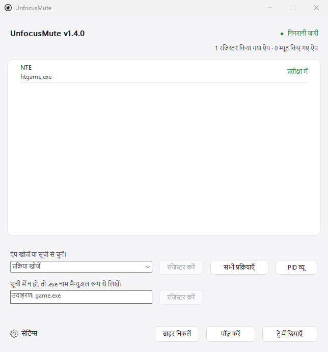

<div align="center">
  

  <h1>UnfocusMute</h1>

  <p><strong>एक हल्का Windows ट्रे ऐप, जो चुने गए गेम या ऐप के फ़ोकस खोते ही उसे अपने-आप म्यूट कर देता है।</strong></p>

  <p>
    <a href="../README.md">English</a> · <a href="README_ko.md">한국어</a> · <a href="README_ja.md">日本語</a> · <a href="README_zh-CN.md">简体中文</a> · <a href="README_es.md">Español</a> · <a href="README_fr.md">Français</a> · <a href="README_pt.md">Português</a> · हिन्दी · <a href="README_ar.md">العربية</a>
  </p>

  <p>
    <a href="https://github.com/ilsd7/UnfocusMute/actions/workflows/ci.yml"></a>
    &nbsp;
    
    &nbsp;
    <a href="../LICENSE"></a>
  </p>

  <p>पूरी तरह लोकल &nbsp;·&nbsp; कोई नेटवर्क एक्सेस नहीं &nbsp;·&nbsp; कोई टेलीमेट्री नहीं &nbsp;·&nbsp; इंस्टॉलेशन की ज़रूरत नहीं</p>

  <p>
    <a href="https://github.com/ilsd7/UnfocusMute/releases/latest/download/UnfocusMute-windows-x64.zip">डाउनलोड</a>
    · <a href="#उपयोग">उपयोग</a>
    · <a href="#सुरक्षा-और-गोपनीयता">गोपनीयता</a>
    · <a href="../LICENSE">Apache-2.0</a>
  </p>
</div>

---

UnfocusMute एक छोटा और हल्का Windows ट्रे ऐप है, जो चुने गए गेम या ऐप के बैकग्राउंड में जाने पर उसे अपने-आप म्यूट करता है और उसके फिर से फ़ोरग्राउंड में आने पर अनम्यूट कर देता है।

अगर गेम में बैकग्राउंड में आवाज़ बंद करने का विकल्प नहीं है, तो आप उसे चालू छोड़कर `Alt`+`Tab` से दूसरी विंडो में काम कर सकते हैं। इस दौरान गेम की आवाज़ बंद रहेगी। यह सुविधा ब्राउज़र और मीडिया प्लेयर के लिए भी काम करती है। आपने जिन ऐप्स को खुद म्यूट किया है, वे म्यूट रहते हैं।

यह ऐप Rust में लिखा गया है। इसकी निष्पादन योग्य फ़ाइल लगभग 600 KB की है।

<p align="center">
  
</p>

---

## डाउनलोड और चलाएँ

x64 डाउनलोड Windows 10 के संस्करण 1703 या बाद के संस्करणों और Windows 11 पर चलता है।

| नवीनतम पैकेज |
| --- |
| [UnfocusMute-windows-x64.zip](https://github.com/ilsd7/UnfocusMute/releases/latest/download/UnfocusMute-windows-x64.zip) |
| [SHA-256 फ़ाइल](https://github.com/ilsd7/UnfocusMute/releases/latest/download/UnfocusMute-windows-x64.zip.sha256) · [रिलीज़ नोट्स](https://github.com/ilsd7/UnfocusMute/releases/latest) |

ZIP निकालने के बाद `UnfocusMute-windows-x64` फ़ोल्डर को अपनी पसंद की जगह पर ले जाएँ और `UnfocusMute-v<version>.exe` चलाएँ। इंस्टॉलेशन, किसी अतिरिक्त रनटाइम या विकास टूल की ज़रूरत नहीं है।

> **नोट:** लागत के कारण UnfocusMute को Windows कोड साइनिंग के बिना वितरित किया जाता है। इसलिए पहली बार चलाते समय Windows SmartScreen या "अज्ञात प्रकाशक" चेतावनी दिख सकती है। फ़ाइल का स्रोत और उसकी अखंडता खुद जाँचने के लिए [पारदर्शिता और रिलीज़ फ़ाइलों का सत्यापन](#पारदर्शिता-और-रिलीज़-फ़ाइलों-का-सत्यापन) देखें।

<br>

## उपयोग

1. UnfocusMute चलाएँ। पहली बार चलाने पर भाषा और स्टार्टअप विकल्प चुनें, फिर `शुरू करें` दबाएँ।
2. जिस गेम या ऐप को रजिस्टर करना है उसे खोलें और कोई आवाज़ चलाएँ, ताकि वह सूची में दिखाई दे।
3. UnfocusMute पर लौटें, सूची से ऐप चुनें और `रजिस्टर करें` दबाएँ।
4. `Alt`+`Tab` से दूसरी विंडो पर जाएँ। रजिस्टर किए गए ऐप की आवाज़ बंद हो जानी चाहिए और उस पर लौटने पर फिर सुनाई देनी चाहिए।

> **ऐप सूची में नहीं दिख रहा?** `सभी प्रक्रियाएँ` दबाएँ या उसकी निष्पादन योग्य फ़ाइल का पूरा नाम सीधे दर्ज करें।

### निष्पादन योग्य फ़ाइल का नाम कैसे देखें

1. जिस गेम या ऐप को रजिस्टर करना है, उसे शुरू करें और फिर Windows का कार्य प्रबंधक खोलें।
2. `प्रक्रियाएँ` में सूची को `CPU` उपयोग के घटते क्रम में लगाएँ, फिर उस ऐप पर राइट-क्लिक करके `गुण` चुनें।
3. गुण विंडो में एक्सटेंशन सहित निष्पादन योग्य फ़ाइल का नाम देखें, फिर UnfocusMute में उस ऐप को रजिस्टर करें।

### आम तौर पर इस्तेमाल होने वाले विकल्प

- सूची में किसी ऐप पर राइट-क्लिक करके उसकी निगरानी रोकें, फिर शुरू करें या उसे सूची से हटाएँ।
- अगर फ़ाइल के नाम से ऐप पहचानना मुश्किल हो, तो `नोट संपादित करें` चुनकर एक विवरण लिखें। यह सूची में फ़ाइल के नाम के ऊपर दिखेगा।
- पूरी निगरानी को पॉज़ या फिर शुरू करने के लिए ऊपर दिए गए `निगरानी जारी` स्टेटस पर क्लिक करें।
- `सेटिंग्स` में ऑटो-स्टार्ट और विंडो बंद करने पर होने वाली कार्रवाई बदली जा सकती है।
- डिफ़ॉल्ट सेटिंग में विंडो बंद करने पर भी UnfocusMute सिस्टम ट्रे में चलता रहता है। पूरी तरह बाहर निकलने के लिए ट्रे आइकन पर राइट-क्लिक करें और `बाहर निकलें` चुनें।

<br>

## ध्यान देने योग्य व्यवहार

**PID से रजिस्ट्रेशन:** निष्पादन योग्य फ़ाइल के नाम से रजिस्टर करने पर उस नाम की सभी प्रक्रियाओं के ऑडियो सेशन म्यूट के दायरे में आते हैं। अगर एक ही ऐप की कई प्रतियाँ चल रही हैं और आप सिर्फ एक की आवाज़ बंद करना चाहते हैं, तो `PID व्यू` में सिर्फ उसका PID रजिस्टर करें। एक PID के सारे ऑडियो सेशन एक साथ म्यूट होते हैं। ऐप दोबारा शुरू करने पर PID बदल जाए तो नया PID रजिस्टर करें।

Windows में ऑडियो सेशन और सामने की विंडो के PID अलग हो सकते हैं। इसलिए सिर्फ PID से हमेशा पता नहीं चलता कि आवाज़ किस विंडो से आ रही है। इसी वजह से उसी नाम की निष्पादन योग्य फ़ाइल की किसी विंडो पर जाने से UnfocusMute आवाज़ फिर चालू कर देता है। उसी ऐप की दूसरी विंडो इस्तेमाल करते हुए आप किसी एक PID को लगातार म्यूट नहीं रख सकते। किसी दूसरे ऐप में काम करते समय आप सिर्फ रजिस्टर किए गए PID को म्यूट करके बाकी की आवाज़ सुनते रह सकते हैं।

**एंटी-चीट संगतता:** UnfocusMute सक्रिय विंडो की जानकारी Windows से लेता है और आवाज़ को CoreAudio से नियंत्रित करता है। यह गेम के बाहर काम करता है, इसलिए हमें उम्मीद है कि यह ज़्यादातर एंटी-चीट सिस्टम के साथ चलेगा, लेकिन हर गेम के लिए इसकी गारंटी नहीं है।

<br>

## समस्या निवारण

- **ऐप की आवाज़ सुनाई नहीं देती:** अगर UnfocusMute अचानक बंद हो जाए, तो ऐप म्यूट रह सकता है। Windows का `वॉल्यूम मिक्सर` खोलें और उस ऐप का म्यूट हटाएँ।
- **ऐप सूची में नहीं दिखता:** ऐप में कोई आवाज़ चलाएँ और सूची दोबारा खोलें। अगर ऐप फिर भी न दिखे, तो [निष्पादन योग्य फ़ाइल का नाम ढूँढें](#निष्पादन-योग्य-फ़ाइल-का-नाम-कैसे-देखें)।
- **ऐप म्यूट नहीं होता:** देखें कि ऊपर की स्थिति `निगरानी जारी` हो और रजिस्टर किया गया ऐप `पॉज़ किया गया` न हो। कोई ड्राइवर, अनुमति सेटिंग या सुरक्षा प्रोग्राम Windows ऑडियो सेशन तक पहुँच सीमित करे, तब भी यह सुविधा काम नहीं कर सकती।
- **PID रजिस्ट्रेशन उम्मीद के मुताबिक काम नहीं करता:** [PID रजिस्ट्रेशन का व्यवहार](#ध्यान-देने-योग्य-व्यवहार) देखें।
- **स्थिति `ध्यान दें` में बदलती है:** स्थिति के पास `विवरण` दबाकर त्रुटि देखें।

समस्या बनी रहे, तो [GitHub पर इश्यू खोलकर](https://github.com/ilsd7/UnfocusMute/issues/new/choose) हमें बताएँ।

अगर आपको सुरक्षा भेद्यता का संदेह हो, तो सार्वजनिक इश्यू में विवरण न लिखें। निजी रिपोर्टिंग प्रक्रिया का उपयोग करें और अधिक जानकारी के लिए [SECURITY.md](../SECURITY.md) देखें।

<br>

## सेटिंग्स फ़ाइल

अगर सेटिंग्स फ़ाइल सीधे देखनी या उसका बैकअप लेना हो, तो सेटिंग्स स्क्रीन में `सेटिंग्स फ़ोल्डर खोलें` बटन पर क्लिक करें। फ़ाइल एक्सप्लोरर में वही `%APPDATA%\UnfocusMute` फ़ोल्डर खुल जाएगा जहाँ सेटिंग्स सहेजी जाती हैं।

आप `config.json` को सीधे संपादित भी कर सकते हैं। अगर उसका फ़ॉर्मैट गलत हो और उसे पढ़ा न जा सके, तो UnfocusMute मूल फ़ाइल को `config.invalid-<timestamp>.json` के रूप में बैकअप करके डिफ़ॉल्ट मानों या ऐप की मौजूदा सेटिंग्स के आधार पर नई सेटिंग्स फ़ाइल बनाता है।

<br>

## सुरक्षा और गोपनीयता

UnfocusMute पूरी तरह स्थानीय रूप से काम करने वाला ऐप है। इंटरनेट कनेक्शन न होने पर भी यह सामान्य रूप से चलता है और इसे एडमिन अधिकारों की ज़रूरत नहीं होती। यह अपने आप नेटवर्क अनुरोध नहीं करता, टेलीमेट्री इस्तेमाल नहीं करता, क्रैश रिपोर्ट नहीं भेजता, रिमोट लॉगिंग नहीं करता और डेटा इकट्ठा नहीं करता।

अपवाद सिर्फ इतना है कि जब आप सेटिंग्स में `GitHub रिपॉज़िटरी` बटन खुद दबाते हैं, तभी इस प्रोजेक्ट की GitHub रिपॉज़िटरी आपके डिफ़ॉल्ट ब्राउज़र में खुलती है।

ऑडियो सेशन पहचान और म्यूट नियंत्रण के लिए सिर्फ Windows CoreAudio API का इस्तेमाल होता है। UnfocusMute लक्षित प्रक्रियाओं में कोड इंजेक्ट नहीं करता, उनकी मेमोरी नहीं पढ़ता और इनपुट हुक नहीं करता।

### सहेजी जाने वाली जानकारी

UnfocusMute काम करने के लिए ज़रूरी सेटिंग्स ही `%APPDATA%\UnfocusMute\config.json` में सहेजता है।

- रजिस्टर की गई प्रक्रियाओं के नाम
- सीधे रजिस्टर किए गए PID
- हर रजिस्टर किए गए ऐप को UnfocusMute ने म्यूट किया है या नहीं
- आपके लिखे नोट
- चुनी हुई भाषा और सेटिंग्स
- विंडो की स्थिति और आकार

यह जानकारी कहीं बाहर नहीं भेजी जाती।

हालाँकि, अगर Windows साइन-इन पर अपने आप शुरू करना चालू किया जाए, तो मौजूदा `.exe` फ़ाइल का पथ भी `HKEY_CURRENT_USER\Software\Microsoft\Windows\CurrentVersion\Run` के `UnfocusMute` मान में सहेजा जाता है।

### न सहेजी जाने वाली जानकारी

UnfocusMute इस्तेमाल का इतिहास, गतिविधि लॉग, त्रुटि लॉग, ऑडियो डेटा, विंडो शीर्षक, कीबोर्ड इनपुट या ऊपर “सहेजी जाने वाली जानकारी” में साफ़ तौर पर न लिखी गई कोई भी जानकारी नहीं सहेजता।

### UnfocusMute को पूरी तरह हटाएँ

1. अगर `Windows साइन-इन पर ऑटो-स्टार्ट` चालू किया था, तो पहले `सेटिंग्स` में इसे बंद करें।
2. ट्रे आइकन पर राइट-क्लिक करें और `बाहर निकलें` चुनें।
3. `UnfocusMute-windows-x64` और `%APPDATA%\UnfocusMute` फ़ोल्डर हटा दें।

अगर `.exe` फ़ाइल पहले ही हटा चुके हैं और ऑटो-स्टार्ट बंद नहीं कर सकते, तो `HKEY_CURRENT_USER\Software\Microsoft\Windows\CurrentVersion\Run` से `UnfocusMute` मान हटाएँ।

<br>

## पारदर्शिता और रिलीज़ फ़ाइलों का सत्यापन

UnfocusMute को सामान्य परिवेश में सुरक्षित रूप से इस्तेमाल करने के लिए बनाया गया है, इसलिए अधिकांश उपयोगकर्ताओं को नीचे दिए गए सत्यापन चरण अलग से करने की ज़रूरत नहीं है। अगर आप केवल डेवलपर के भरोसे नहीं रहना चाहते या सॉफ़्टवेयर सप्लाई-चेन सुरक्षा को विशेष महत्व देते हैं, तो इस सार्वजनिक प्रक्रिया से डाउनलोड की गई फ़ाइलों के स्रोत और अखंडता की जाँच कर सकते हैं।

### अलग सत्यापन क्यों आवश्यक है

रिपॉज़िटरी के स्रोत कोड की स्वयं समीक्षा करके उसे सुरक्षित मान लेने के बाद भी यह तय नहीं किया जा सकता कि GitHub रिलीज़ में प्रकाशित फ़ाइलें वास्तव में उसी स्रोत से बनाई गई हैं। डेवलपर का खाता हैक होने या रिलीज़ अनुमतियों के दुरुपयोग की स्थिति में प्रकाशित स्रोत कोड से असंबंधित फ़ाइलें वितरित की जा सकती हैं।

SHA-256 हैश की तुलना से यह पुष्टि हो सकती है कि डाउनलोड की गई फ़ाइल प्रकाशित चेकसम से मेल खाती है, लेकिन यह साबित नहीं होता कि फ़ाइल किस स्रोत कोड और बिल्ड परिवेश से बनी है।

इन सप्लाई-चेन जोखिमों को पारदर्शी ढंग से संभालने के लिए UnfocusMute यह जाँचने का तरीका प्रकाशित करता है कि GitHub रिलीज़ की फ़ाइल उस रिलीज़ टैग से जुड़े कमिट से GitHub Actions द्वारा बनाया गया आधिकारिक बिल्ड आर्टिफ़ैक्ट है।

<details>
<summary>रिलीज़ फ़ाइल सत्यापन के चरण देखें</summary>

[GitHub CLI](https://cli.github.com/) इंस्टॉल करें और जिस फ़ोल्डर में आपने ZIP डाउनलोड किया है, उसमें PowerShell खोलें। अगर चेकसम भी मिलाना है, तो उसी रिलीज़ की `.sha256` फ़ाइल भी उसी फ़ोल्डर में सहेजें। नीचे `$version` में उस रिलीज़ का टैग दर्ज करें जिसे आप सत्यापित करना चाहते हैं, फिर कमांड चलाएँ।

```powershell
$version = "v1.5.0"
$sourceRef = "refs/tags/$version"
$workflow = "ilsd7/UnfocusMute/.github/workflows/release.yml"

gh attestation verify .\UnfocusMute-windows-x64.zip `
  -R ilsd7/UnfocusMute `
  --source-ref $sourceRef `
  --signer-workflow $workflow
```

यह कमांड GitHub की attestation सेवा से संपर्क करके जाँचता है कि स्थानीय ZIP का SHA-256, GitHub Actions द्वारा हस्ताक्षरित बिल्ड-उत्पत्ति प्रमाण में दर्ज हैश से मेल खाता है।

आप ZIP की तुलना रिलीज़ में प्रकाशित SHA-256 हैश से भी कर सकते हैं।

```powershell
$expectedHash = ((Get-Content .\UnfocusMute-windows-x64.zip.sha256 -TotalCount 1) -split '\s+')[0]
$actualHash = (Get-FileHash .\UnfocusMute-windows-x64.zip -Algorithm SHA256).Hash

if ($actualHash -ne $expectedHash) {
  throw "SHA-256 सत्यापन विफल हुआ।"
}

"SHA-256 सत्यापित: $actualHash"
```

सफल सत्यापन पुष्टि करता है कि डाउनलोड की गई ZIP बताए गए रिलीज़ टैग के लिए निर्दिष्ट GitHub Actions वर्कफ़्लो ने बनाई थी और वह अपनी attestation में दर्ज हैश से मेल खाती है।

यह स्रोत कोड की स्वयं की सुरक्षा, पूरे GitHub परिवेश की अखंडता या किसी दूसरे कंप्यूटर पर बाइट-दर-बाइट समान पुनरुत्पाद्य बिल्ड को साबित नहीं करता।

</details>

<br>

## सोर्स से बिल्ड करें

अनुशंसित रिलीज़ लक्ष्य `x86_64-pc-windows-msvc` है।

ज़रूरी टूल:

- Rust stable
- Visual Studio Build Tools 2022 या Visual Studio 2022
- Windows 10/11 SDK

`THIRD_PARTY_NOTICES.md` को अपडेट करने के लिए `cargo-about` भी ज़रूरी है।

<details>
<summary>बिल्ड और पैकेजिंग कमांड देखें</summary>

```powershell
rustup target add x86_64-pc-windows-msvc
cargo build --release --target x86_64-pc-windows-msvc --locked
```

रिलीज़ बिल्ड छोटे बाइनरी आकार के लिए कॉन्फ़िगर किए गए हैं। `Cargo.toml` की रिलीज़ प्रोफ़ाइल सिंबल हटाती है, LTO सक्षम करती है, एक ही कोड जनरेशन यूनिट (codegen unit) इस्तेमाल करती है, `panic = "abort"` सेट करती है और आकार के लिए अनुकूलित करती है।

`.exe` फ़ाइल:

```text
target\x86_64-pc-windows-msvc\release\unfocusmute.exe
```

वितरण ZIP:

```powershell
powershell -NoProfile -ExecutionPolicy Bypass -File scripts\package-windows.ps1
```

जब थर्ड-पार्टी लाइसेंस नोटिस अपडेट करना हो:

```powershell
cargo about generate about.hbs -c about.toml --locked --offline -o THIRD_PARTY_NOTICES.md
```

परिणाम `dist\UnfocusMute-windows-x64.zip` में बनता है, और उसी जगह SHA-256 जाँच फ़ाइल `dist\UnfocusMute-windows-x64.zip.sha256` भी बनती है। ZIP में संस्करण सहित `.exe` फ़ाइल (`UnfocusMute-v<version>.exe`), `LICENSE` और `THIRD_PARTY_NOTICES.md` शामिल होते हैं।

</details>

<br>

## लाइसेंस

Apache License 2.0। जानकारी के लिए [LICENSE](../LICENSE) देखें।

तीसरे पक्ष के Rust crate लाइसेंस नोटिस के लिए [THIRD_PARTY_NOTICES.md](../THIRD_PARTY_NOTICES.md) देखें।
