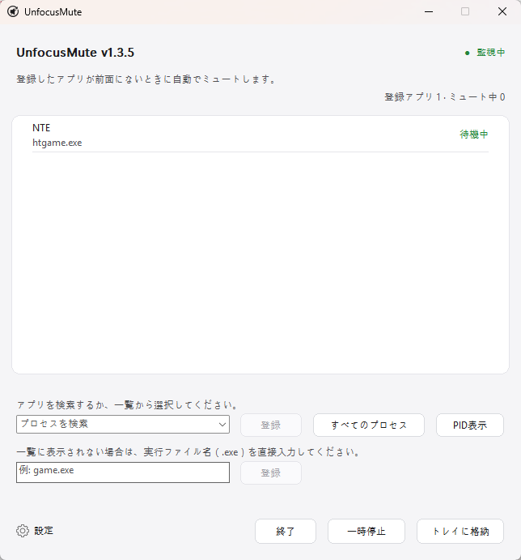

<div align="center">
  

  <h1>UnfocusMute</h1>

  <p><strong>選択したゲームやアプリがフォーカスを失うと自動でミュートする、Windowsのタスクトレイに常駐する軽量アプリです。</strong></p>

  <p>
    <a href="../README.md">English</a> · <a href="README_ko.md">한국어</a> · 日本語 · <a href="README_zh-CN.md">简体中文</a> · <a href="README_es.md">Español</a> · <a href="README_fr.md">Français</a> · <a href="README_pt.md">Português</a> · <a href="README_hi.md">हिन्दी</a> · <a href="README_ar.md">العربية</a>
  </p>

  <p>
    <a href="https://github.com/ilsd7/UnfocusMute/actions/workflows/ci.yml"></a>
    &nbsp;
    
    &nbsp;
    <a href="../LICENSE"></a>
  </p>

  <p>完全にローカルで動作 &nbsp;·&nbsp; ネットワークアクセスなし &nbsp;·&nbsp; テレメトリなし &nbsp;·&nbsp; インストール不要</p>

  <p>
    <a href="https://github.com/ilsd7/UnfocusMute/releases/latest/download/UnfocusMute-windows-x64.zip">ダウンロード</a>
    · <a href="#使い方">使い方</a>
    · <a href="#セキュリティとプライバシー">プライバシー</a>
    · <a href="../LICENSE">Apache-2.0</a>
  </p>
</div>

---

UnfocusMuteは、選択したゲームやアプリがバックグラウンドに移ると自動でミュートし、再び前面に戻るとミュートを解除する、Windows向けのコンパクトで軽量なタスクトレイ常駐アプリです。

バックグラウンドで音を消す設定がないゲームでも、`Alt`+`Tab` で別の作業に移る間だけミュートできます。ブラウザーやメディアプレーヤーにも使えます。自分でミュートしたアプリはそのままです。

Rust製のネイティブアプリで、実行ファイルは約600 KBです。

<p align="center">
  
</p>

---

## ダウンロードと実行

x64版はWindows 10 バージョン1703以降とWindows 11に対応しています。

| 最新の配布ファイル |
| --- |
| [UnfocusMute-windows-x64.zip](https://github.com/ilsd7/UnfocusMute/releases/latest/download/UnfocusMute-windows-x64.zip) |
| [SHA-256 チェックサムファイル](https://github.com/ilsd7/UnfocusMute/releases/latest/download/UnfocusMute-windows-x64.zip.sha256) · [リリースノート](https://github.com/ilsd7/UnfocusMute/releases/latest) |

ZIPを展開したら、`UnfocusMute-windows-x64` フォルダーを任意の場所へ移動し、その中の `UnfocusMute-v<version>.exe` を実行してください。インストール作業や別途ランタイム、開発ツールは必要ありません。

> **参考:** 費用上の理由から、UnfocusMuteはWindows向けのコード署名を付けずに配布しています。そのため、初回実行時にSmartScreenや「不明な発行元」の警告が表示される場合があります。ファイルの配布元と整合性を自分で確認するには、[透明性と配布ファイルの検証](#透明性と配布ファイルの検証)を参照してください。

<br>

## 使い方

1. UnfocusMuteを起動します。初回起動時は、言語と起動オプションを選んで `開始` を押してください。
2. 登録したいゲームやアプリを起動し、一覧に表示されるよう一度音を再生します。
3. UnfocusMuteに戻り、一覧からアプリを選んで `登録` を押します。
4. `Alt`+`Tab` で別のウィンドウに切り替え、登録したアプリの音が消えることを確認します。そのアプリに戻ると音が再開します。

> **アプリが一覧にありませんか？** `すべてのプロセス` を押すか、正確な実行ファイル名を直接入力してください。

### 実行ファイル名を調べる

1. 登録したいゲームやアプリを起動してから、Windowsのタスク マネージャーを開きます。
2. `プロセス` で `CPU` 使用率の高い順に並べ替え、対象のアプリを右クリックして `プロパティ` を選びます。
3. プロパティで拡張子を含む実行ファイル名を確認し、UnfocusMuteでそのアプリを登録します。

### よく使う操作

- 一覧でアプリを右クリックすると、そのアプリの監視を一時停止・再開したり、登録を解除したりできます。
- ファイル名だけでは見分けにくい場合は、`メモを編集` で説明を追加できます。メモは一覧のファイル名の上に表示されます。
- 上部の `監視中` を押すと、監視全体を一時停止または再開できます。
- `設定` では、自動起動やウィンドウを閉じたときの動作を変更できます。
- 初期設定では、ウィンドウを閉じてもタスクトレイで動作を続けます。 完全に終了するには、トレイアイコンを右クリックして `終了` を選んでください。

<br>

## 知っておきたい動作

**PID登録:** 実行ファイル名で登録すると、同じ名前で動くすべてのプロセスのオーディオセッションがミュートの対象になります。同じアプリを複数起動していて、そのうち1つだけをミュートしたい場合は、`PID表示` でそのPIDだけを登録します。同じPIDに複数のセッションがある場合は、まとめてミュートされます。アプリの再起動でPIDが変わったら、新しいPIDを登録してください。

Windowsではオーディオセッションと前面のウィンドウのPIDが異なることがあり、PIDだけで音声とウィンドウを対応付けるには限界があります。そのため、同じ実行ファイル名のウィンドウに切り替えても、UnfocusMuteは登録したアプリに戻ったと判断してミュートを解除します。同じアプリの別のウィンドウを使いながら特定のPIDだけをミュートしたままにはできませんが、別のアプリで作業している間は、登録したPIDだけをミュートしてほかのインスタンスの音を聞くことができます。

**アンチチートとの互換性:** UnfocusMuteはWindowsで前面のウィンドウを確認し、CoreAudioで音声を制御します。ゲームに直接介入しないため、ほとんどのアンチチートとは競合しないと考えていますが、すべてのゲームでの互換性を保証するものではありません。

<br>

## トラブルシューティング

- **アプリの音が聞こえない:** UnfocusMuteが異常終了すると、アプリがミュートされたままになることがあります。Windowsの `音量ミキサー` を開き、そのアプリのミュートを解除してください。
- **アプリが一覧にない:** アプリで音を再生してから、一覧を開き直してください。それでも表示されない場合は、[実行ファイル名を調べてください](#実行ファイル名を調べる)。
- **ミュートされない:** 上部の状態が `監視中` になっていることと、登録したアプリが `一時停止中` でないことを確認してください。ドライバー、権限設定、セキュリティソフトがWindowsのオーディオセッションへのアクセスを制限している場合も、動作しないことがあります。
- **PID登録が想定どおりに動作しない:** [PID登録の動作](#知っておきたい動作)を確認してください。
- **状態が `要確認` に変わった:** 状態表示の横にある `詳細` を押して、エラー内容を確認してください。

問題が解決しない場合は、[GitHub Issue](https://github.com/ilsd7/UnfocusMute/issues/new/choose)でお知らせください。

セキュリティ脆弱性が疑われる場合は、公開のIssueに詳細を書かず、非公開で報告してください。詳しくは [SECURITY.md](../SECURITY.md) を確認してください。

<br>

## 設定ファイル

設定ファイルを直接確認したりバックアップしたりする場合は、設定画面の `設定フォルダーを開く` をクリックしてください。設定ファイルが保存されている `%APPDATA%\UnfocusMute` フォルダーがエクスプローラーで開きます。

`config.json` は直接編集することもできます。形式が正しくなく読み取れない場合は、元のファイルを `config.invalid-<timestamp>.json` としてバックアップし、既定値または現在のアプリ設定をもとに新しい設定ファイルを作成します。

<br>

## セキュリティとプライバシー

UnfocusMuteは完全にローカルで動作するアプリです。インターネット接続がなくても通常どおり動作し、管理者権限を要求しません。自動的なネットワークリクエスト、テレメトリ、クラッシュレポート、リモートログ送信、データ収集も行いません。

例外として、ユーザーが設定画面の `GitHub リポジトリ` ボタンを押した場合にのみ、このプロジェクトの GitHub リポジトリが既定のブラウザーで開きます。

オーディオセッションの検出とミュート制御にはWindows CoreAudio APIだけを使用します。対象プロセスにコードを注入したり、メモリを読んだり、入力をフックしたりしません。

### 保存する情報

UnfocusMuteは動作に必要な設定だけを `%APPDATA%\UnfocusMute\config.json` に保存します。

- 登録したプロセス名
- 直接登録したPID
- 登録した各アプリをUnfocusMuteがミュートしたかどうか
- 入力したメモ
- 選択した言語と設定
- ウィンドウの位置とサイズ

これらの情報は外部へ送信されません。

ただし、Windows サインイン時の自動起動を有効にすると、現在の実行ファイルパスも `HKEY_CURRENT_USER\Software\Microsoft\Windows\CurrentVersion\Run` の `UnfocusMute` 値に保存されます。

### 保存しない情報

上の「保存する情報」に記載した項目以外は保存しません。使用履歴、アクティビティログ、エラーログ、オーディオデータ、ウィンドウタイトル、キー入力も保存しません。

### 完全に削除する

1. `Windows サインイン時に自動起動` を有効にしている場合は、先に `設定` で無効にします。
2. トレイアイコンを右クリックし、`終了` を選んでUnfocusMuteを終了します。
3. `UnfocusMute-windows-x64` フォルダーと `%APPDATA%\UnfocusMute` フォルダーを削除します。

自動起動を無効にする前に実行ファイルを削除した場合は、`HKEY_CURRENT_USER\Software\Microsoft\Windows\CurrentVersion\Run` の `UnfocusMute` 値を削除してください。

<br>

## 透明性と配布ファイルの検証

UnfocusMuteは一般的な環境で安全に使用できるよう設計されているため、ほとんどのユーザーは以下の検証手順を別途実行する必要はありません。開発者への信頼だけに依存したくない場合や、ソフトウェアのサプライチェーンセキュリティを重視する場合は、公開されている手順でダウンロードしたファイルの出所と完全性を確認できます。

### 別途検証が必要な理由

リポジトリのソースコードを自分で確認して安全だと判断しても、GitHubリリースで公開されたファイルが実際にそのソースから作成されたとは限りません。開発者アカウントが侵害されたり、リリース権限が悪用されたりすると、公開されたソースコードとは無関係なファイルが配布される可能性があるためです。

SHA-256ハッシュの比較では、ダウンロードしたファイルが公開されたチェックサムと一致することは確認できますが、どのソースコードとビルド環境から生成されたかまでは証明できません。

このようなサプライチェーン上のリスクを透明に扱うため、UnfocusMuteは、GitHubリリースのファイルが該当するリリースタグが指すコミットを基にGitHub Actionsで生成された公式ビルド成果物であることを直接検証する方法を公開しています。

<details>
<summary>配布ファイルの検証手順を表示</summary>

[GitHub CLI](https://cli.github.com/)をインストールし、ZIPをダウンロードしたフォルダーでPowerShellを開きます。チェックサムも比較する場合は、同じリリースの`.sha256`ファイルをそのフォルダーに保存してください。以下の`$version`を検証するリリースタグに変更してから、コマンドを実行します。

```powershell
$version = "v1.5.0"
$sourceRef = "refs/tags/$version"
$workflow = "ilsd7/UnfocusMute/.github/workflows/release.yml"

gh attestation verify .\UnfocusMute-windows-x64.zip `
  -R ilsd7/UnfocusMute `
  --source-ref $sourceRef `
  --signer-workflow $workflow
```

このコマンドはGitHubのattestationサービスに接続し、ローカルZIPのSHA-256が、GitHub Actionsによって署名されたビルド来歴に記録された値と一致するかを確認します。

リリースで公開されたSHA-256ハッシュと比較することもできます。

```powershell
$expectedHash = ((Get-Content .\UnfocusMute-windows-x64.zip.sha256 -TotalCount 1) -split '\s+')[0]
$actualHash = (Get-FileHash .\UnfocusMute-windows-x64.zip -Algorithm SHA256).Hash

if ($actualHash -ne $expectedHash) {
  throw "SHA-256の検証に失敗しました。"
}

"SHA-256の検証に成功しました: $actualHash"
```

検証に成功すると、ダウンロードしたZIPが指定したリリースタグに基づいて該当するGitHub Actionsワークフローで生成され、attestationに記録されたハッシュと一致することを確認できます。

ただし、ソースコード自体の安全性、GitHub環境全体の完全性、または別のコンピューターでもバイト単位で同じ結果になる再現可能なビルドまで証明するものではありません。

</details>

<br>

## 自分でビルドする

推奨リリースターゲットは `x86_64-pc-windows-msvc` です。

必要なツール:

- Rust stable
- Visual Studio Build Tools 2022 または Visual Studio 2022
- Windows 10/11 SDK

`THIRD_PARTY_NOTICES.md` を更新する場合は、`cargo-about` も必要です。

<details>
<summary>ビルドとパッケージ作成のコマンドを表示</summary>

```powershell
rustup target add x86_64-pc-windows-msvc
cargo build --release --target x86_64-pc-windows-msvc --locked
```

リリースビルドはファイルサイズを小さくするように設定されています。`Cargo.toml` のリリースプロファイルでは、シンボルの削除、LTO、`codegen-units = 1`、`panic = "abort"`、サイズ優先の最適化を使用しています。

実行ファイル:

```text
target\x86_64-pc-windows-msvc\release\unfocusmute.exe
```

配布ZIP:

```powershell
powershell -NoProfile -ExecutionPolicy Bypass -File scripts\package-windows.ps1
```

サードパーティライセンス表記を更新する場合:

```powershell
cargo about generate about.hbs -c about.toml --locked --offline -o THIRD_PARTY_NOTICES.md
```

成果物は `dist\UnfocusMute-windows-x64.zip` に作成され、同じ場所に SHA-256 チェックサムファイル `dist\UnfocusMute-windows-x64.zip.sha256` も作成されます。ZIPには、バージョン付きの実行ファイル（`UnfocusMute-v<version>.exe`）、`LICENSE`、`THIRD_PARTY_NOTICES.md`が含まれます。

</details>

<br>

## ライセンス

Apache License 2.0です。詳しくは[LICENSE](../LICENSE)を確認してください。

サードパーティの Rust crate のライセンス表記は[THIRD_PARTY_NOTICES.md](../THIRD_PARTY_NOTICES.md)を確認してください。
