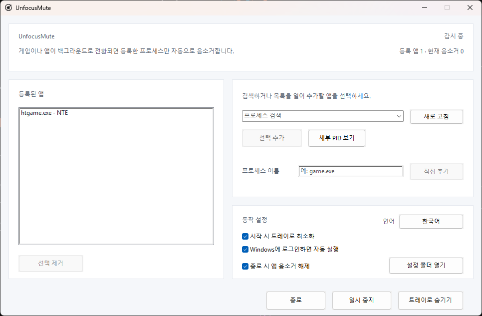

<div align="center">
  

  <h1>UnfocusMute</h1>

  <p><strong>선택한 게임이나 앱이 포커스를 잃으면 자동으로 음소거하는 가벼운 Windows 트레이 앱입니다.</strong></p>

  <p>
    <a href="../README.md">English</a> · 한국어 · <a href="README_ja.md">日本語</a> · <a href="README_zh-CN.md">简体中文</a> · <a href="README_es.md">Español</a> · <a href="README_fr.md">Français</a> · <a href="README_pt.md">Português</a> · <a href="README_hi.md">हिन्दी</a> · <a href="README_ar.md">العربية</a>
  </p>

  <p>
    <a href="https://github.com/ilsd7/UnfocusMute/actions/workflows/ci.yml"></a>
    &nbsp;
    
    &nbsp;
    <a href="../LICENSE"></a>
  </p>

  <p>완전 로컬 &nbsp;·&nbsp; 네트워크 접근 없음 &nbsp;·&nbsp; 텔레메트리 없음 &nbsp;·&nbsp; 설치 필요 없음</p>

  <p>
    <a href="https://github.com/ilsd7/UnfocusMute/releases/latest/download/UnfocusMute-windows-x64.zip">다운로드</a>
    · <a href="#사용-방법">사용 방법</a>
    · <a href="#보안-및-개인정보">개인정보</a>
    · <a href="../LICENSE">Apache-2.0</a>
  </p>
</div>

---

UnfocusMute는 선택한 게임이나 앱이 백그라운드로 전환되면 자동으로 음소거하고, 다시 전면으로 돌아오면 음소거를 해제하는 작고 가벼운 Windows 트레이 앱입니다.

백그라운드 음소거 옵션이 없는 게임을 켜 둔 채 `Alt`+`Tab`으로 다른 작업을 할 때 유용합니다. 브라우저나 미디어 플레이어에도 같은 방식으로 적용할 수 있습니다. 직접 음소거한 앱은 계속 음소거 상태로 유지됩니다.

Rust로 만든 네이티브 앱이며, 실행 파일 크기는 약 600KB입니다.

<p align="center">
  
</p>

---

## 다운로드 및 실행

Windows 10 버전 1703 이상과 Windows 11에서 사용할 수 있습니다. 아래 ZIP은 64비트(x64)용입니다.

| 최신 배포 파일 |
| --- |
| [UnfocusMute-windows-x64.zip](https://github.com/ilsd7/UnfocusMute/releases/latest/download/UnfocusMute-windows-x64.zip) |
| [SHA-256 확인 파일](https://github.com/ilsd7/UnfocusMute/releases/latest/download/UnfocusMute-windows-x64.zip.sha256) · [릴리스 노트](https://github.com/ilsd7/UnfocusMute/releases/latest) |

압축을 푼 뒤 `UnfocusMute-windows-x64` 폴더를 원하는 위치로 옮기고, 그 안의 `UnfocusMute-v<version>.exe`를 실행하세요. 설치 과정이나 별도 런타임, 개발 도구는 필요하지 않습니다.

> **참고:** 비용 문제로 인해 Windows 코드 서명 없이 배포됩니다. 따라서 처음 실행할 때 SmartScreen 또는 "알 수 없는 게시자" 경고가 표시될 수 있습니다. 파일의 출처와 무결성을 직접 확인하려면 [투명성 및 배포 파일 검증](#투명성-및-배포-파일-검증)을 참고하세요.

<br>

## 사용 방법

1. UnfocusMute를 실행하세요. 처음 실행하면 언어와 실행 옵션을 고른 뒤 `시작`을 누르세요.
2. 등록할 게임이나 앱을 실행하고, 목록에 표시되도록 소리를 한 번 재생하세요.
3. UnfocusMute로 돌아와 목록에서 앱을 선택하고 `등록`을 누르세요.
4. `Alt`+`Tab`으로 다른 창에 가면 등록한 앱의 소리가 꺼지는지, 그 앱으로 돌아오면 다시 들리는지 확인하세요.

> **앱이 목록에 없나요?** `모든 프로세스`를 누르거나 정확한 실행 파일 이름을 직접 입력하세요.

### 실행 파일 이름 찾기

1. 원하는 게임이나 앱을 실행한 뒤, Windows 작업 관리자를 여세요.
2. `프로세스` 목록에서 `CPU` 사용량이 높은 순으로 정렬한 뒤, 대상 앱을 마우스 오른쪽 버튼으로 클릭하고 `속성`을 선택하세요.
3. 속성 창에서 확장자를 포함한 실행 파일 이름을 확인한 뒤, UnfocusMute에서 해당 앱을 등록하세요.

### 자주 쓰는 기능

- 등록 목록에서 앱을 마우스 오른쪽 버튼으로 클릭하면 해당 앱의 모니터링을 일시 중지하거나 재개할 수 있습니다. 같은 메뉴에서 등록을 해제할 수도 있습니다.
- 실행 파일 이름을 구분하기 어려우면 `메모 편집`으로 설명을 붙이세요. 메모는 등록 목록에서 이름 위에 표시됩니다.
- 위쪽의 `모니터링 중` 상태를 누르면 전체 모니터링을 일시 중지하거나 재개할 수 있습니다.
- `설정`에서 자동 실행과 창 닫기 동작을 바꿀 수 있습니다.
- 기본 설정에서는 창을 닫아도 트레이에서 계속 실행됩니다. 완전히 종료하려면 트레이 아이콘을 마우스 오른쪽 버튼으로 클릭해 `종료`를 선택하세요.

<br>

## 알아두면 좋은 동작

**PID 등록:** 실행 파일 이름으로 등록하면 그 이름으로 실행된 모든 프로세스의 오디오 세션이 음소거 대상이 됩니다. 같은 앱을 여러 개 실행해 두고 그중 하나만 음소거하려면 `PID 보기`에서 원하는 PID만 등록하세요. 해당 PID에 오디오 세션이 여러 개 있으면 함께 음소거됩니다. 앱을 다시 실행해 PID가 바뀌면 새 PID를 등록하세요.

Windows에서는 오디오 세션과 전면 창의 PID가 다를 수 있어, PID만으로는 어느 창에서 소리가 나는지 구분하는 데 한계가 있습니다. 이 때문에 UnfocusMute는 실행 파일 이름이 같은 창으로 전환해도 등록한 앱으로 돌아온 것으로 보고 음소거를 해제합니다. 같은 앱의 다른 창을 쓰면서 특정 PID만 계속 음소거할 수는 없지만, 다른 앱에서 작업하는 동안에는 등록한 PID의 소리만 끄고 나머지는 계속 들을 수 있습니다.

**안티치트 호환성:** UnfocusMute는 Windows에서 활성 창을 확인하고 CoreAudio로 음소거를 제어합니다. 게임에 직접 개입하지 않아 대부분의 안티치트와 충돌하지 않을 것으로 예상하지만, 모든 게임에서의 호환성을 보장할 수는 없습니다.

<br>

## 문제 해결

- **앱의 소리가 들리지 않음:** UnfocusMute가 비정상 종료되면 앱이 음소거 상태로 남을 수 있습니다. Windows `볼륨 믹서`를 열어 해당 앱의 음소거를 해제하세요.
- **앱이 목록에 없음:** 앱에서 소리를 재생한 뒤 목록을 다시 여세요. 그래도 보이지 않으면 [실행 파일 이름 찾기](#실행-파일-이름-찾기)를 참고하세요.
- **음소거되지 않음:** 위쪽 상태가 `모니터링 중`인지, 등록한 앱이 `일시 중지됨` 상태는 아닌지 확인하세요. 드라이버, 권한 설정, 보안 프로그램이 Windows 오디오 세션 접근을 제한하는 경우에도 동작하지 않을 수 있습니다.
- **PID 등록이 예상과 다름:** [PID 등록 동작](#알아두면-좋은-동작)을 확인하세요.
- **상태가 `주의`로 바뀜:** 상태 표시 옆의 `세부 정보`를 눌러 오류 내용을 확인하세요.

문제가 계속되면 [GitHub 이슈](https://github.com/ilsd7/UnfocusMute/issues/new/choose)를 열어 알려 주세요.

보안 취약점이 의심된다면 공개 이슈에 세부 정보를 올리지 말고 비공개로 제보해 주세요. 자세한 방법은 [SECURITY.md](../SECURITY.md)를 참고하세요.

<br>

## 설정 파일

설정 파일을 직접 확인하거나 백업하려면 설정 화면의 `설정 폴더 열기` 버튼을 클릭하세요. 설정 파일이 저장되는 `%APPDATA%\UnfocusMute` 폴더가 파일 탐색기에서 열립니다.

`config.json`을 직접 편집할 수도 있습니다. 형식이 잘못되어 읽을 수 없으면 원본을 `config.invalid-<timestamp>.json`으로 백업한 뒤, 기본값 또는 현재 앱 설정을 바탕으로 새 설정 파일을 만듭니다.

<br>

## 보안 및 개인정보

UnfocusMute는 완전히 로컬에서 동작하는 앱입니다. 인터넷 연결 없이도 정상적으로 작동하며, 관리자 권한을 요구하지 않습니다. 자동 네트워크 요청, 텔레메트리, 크래시 리포팅, 원격 로깅, 데이터 수집도 하지 않습니다.

예외적으로 사용자가 설정 화면의 `GitHub 저장소` 버튼을 직접 누른 경우에만, 기본 브라우저에서 이 프로젝트의 GitHub 저장소가 열립니다.

오디오 세션 감지와 음소거 제어에는 Windows CoreAudio API만 사용합니다. 대상 프로세스에 코드를 주입하거나, 메모리를 읽거나, 입력을 후킹하지 않습니다.

### 저장하는 정보

UnfocusMute는 동작에 필요한 설정만 `%APPDATA%\UnfocusMute\config.json`에 저장합니다.

- 등록한 프로세스 이름
- 직접 등록한 PID
- UnfocusMute가 해당 앱을 음소거했는지 여부
- 작성한 메모
- 선택한 언어 및 설정
- 창 위치 및 크기

위 정보는 어디로도 전송되지 않습니다.

단, `Windows 로그인 시 자동 실행`을 켜면 현재 실행 파일 경로가 `HKEY_CURRENT_USER\Software\Microsoft\Windows\CurrentVersion\Run`의 `UnfocusMute` 값에도 저장됩니다.

### 저장하지 않는 정보

위의 "저장하는 정보"에 명시된 항목 외에는 저장하지 않습니다. 사용 기록, 활동 로그, 오류 로그, 오디오 데이터, 창 제목, 키 입력도 저장하지 않습니다.

### 완전히 삭제하기

1. `Windows 로그인 시 자동 실행`을 켰다면 먼저 `설정`에서 끄세요.
2. 트레이 아이콘을 마우스 오른쪽 버튼으로 클릭해 UnfocusMute를 `종료`하세요.
3. `UnfocusMute-windows-x64` 폴더와 `%APPDATA%\UnfocusMute` 폴더를 삭제하세요.

실행 파일을 먼저 지워 자동 실행을 끌 수 없다면, `HKEY_CURRENT_USER\Software\Microsoft\Windows\CurrentVersion\Run`에서 `UnfocusMute` 값을 삭제하세요.

<br>

## 투명성 및 배포 파일 검증

UnfocusMute는 일반적인 환경에서 안전하게 사용할 수 있도록 설계되었으므로, 대부분의 사용자는 아래 검증 절차를 별도로 수행하지 않아도 됩니다. 개발자에 대한 신뢰에만 의존하고 싶지 않거나 소프트웨어 공급망 보안을 중요하게 고려한다면, 공개된 절차를 통해 다운로드한 파일의 출처와 무결성을 확인할 수 있습니다.

### 왜 별도 검증이 필요한가

저장소의 소스 코드를 직접 검토해 안전하다고 판단했더라도, GitHub 릴리스에 게시된 파일이 실제로 그 소스에서 만들어졌다고 단정할 수는 없습니다. 개발자 계정이 탈취되거나 릴리스 권한이 악용되면 공개된 소스 코드와 무관한 파일이 배포될 수 있기 때문입니다.

SHA-256 해시 비교는 다운로드한 파일이 게시된 체크섬과 일치하는지는 확인할 수 있지만, 어떤 소스 코드와 빌드 환경에서 생성되었는지까지 증명하지는 못합니다.

이러한 공급망 위험을 투명하게 다루기 위해 UnfocusMute는 GitHub 릴리스의 파일이 해당 릴리스 태그가 가리키는 커밋을 바탕으로 GitHub Actions에서 생성된 공식 빌드 산출물인지 직접 검증하는 방법을 공개합니다.

<details>
<summary>배포 파일 검증 절차 보기</summary>

[GitHub CLI](https://cli.github.com/)를 설치한 뒤, ZIP을 다운로드한 폴더에서 PowerShell을 여세요. 체크섬도 비교하려면 같은 릴리스의 `.sha256` 파일을 이 폴더에 저장하세요. 아래 `$version`을 검증할 릴리스 태그로 바꾼 다음 명령을 실행하세요.

```powershell
$version = "v1.5.0"
$sourceRef = "refs/tags/$version"
$workflow = "ilsd7/UnfocusMute/.github/workflows/release.yml"

gh attestation verify .\UnfocusMute-windows-x64.zip `
  -R ilsd7/UnfocusMute `
  --source-ref $sourceRef `
  --signer-workflow $workflow
```

이 명령은 GitHub attestation 서비스에 접속해 로컬 ZIP의 SHA-256이 GitHub Actions가 서명한 빌드 출처 증명(attestation)에 기록된 값과 일치하는지 확인합니다.

릴리스의 SHA-256 해시와도 비교할 수 있습니다.

```powershell
$expectedHash = ((Get-Content .\UnfocusMute-windows-x64.zip.sha256 -TotalCount 1) -split '\s+')[0]
$actualHash = (Get-FileHash .\UnfocusMute-windows-x64.zip -Algorithm SHA256).Hash

if ($actualHash -ne $expectedHash) {
  throw "SHA-256 검증에 실패했습니다."
}

"SHA-256 검증 성공: $actualHash"
```

검증에 성공하면 다운로드한 ZIP이 지정한 릴리스 태그를 바탕으로 해당 GitHub Actions 워크플로에서 생성되었으며, attestation에 기록된 해시와 일치한다는 점을 확인할 수 있습니다.

다만 이는 소스 코드 자체의 안전성이나 GitHub 전체 환경의 무결성, 다른 컴퓨터에서도 바이트 단위로 같은 결과가 나오는 재현 가능 빌드까지 증명하지는 않습니다.

</details>

<br>

## 직접 빌드하기

권장 릴리스 타깃은 `x86_64-pc-windows-msvc`입니다.

필요한 도구:

- Rust stable
- Visual Studio Build Tools 2022 또는 Visual Studio 2022
- Windows 10/11 SDK

`THIRD_PARTY_NOTICES.md`를 갱신할 때는 `cargo-about`도 필요합니다.

<details>
<summary>빌드 및 패키징 명령어 보기</summary>

```powershell
rustup target add x86_64-pc-windows-msvc
cargo build --release --target x86_64-pc-windows-msvc --locked
```

릴리스 빌드는 바이너리 크기를 줄이도록 설정되어 있습니다. `Cargo.toml`의 release 프로필은 심볼 제거, LTO, 단일 코드 생성 단위(codegen unit), `panic = "abort"`, 크기 우선 최적화를 사용합니다.

실행 파일:

```text
target\x86_64-pc-windows-msvc\release\unfocusmute.exe
```

배포 ZIP:

```powershell
powershell -NoProfile -ExecutionPolicy Bypass -File scripts\package-windows.ps1
```

서드파티 라이선스 고지를 갱신해야 할 때:

```powershell
cargo about generate about.hbs -c about.toml --locked --offline -o THIRD_PARTY_NOTICES.md
```

결과물은 `dist\UnfocusMute-windows-x64.zip`에 생성되며, 같은 위치에 SHA-256 확인용 `dist\UnfocusMute-windows-x64.zip.sha256`도 함께 만들어집니다. ZIP에는 버전명이 포함된 실행 파일(`UnfocusMute-v<version>.exe`), `LICENSE`, `THIRD_PARTY_NOTICES.md`가 들어 있습니다.

</details>

<br>

## 라이선스

Apache License 2.0. 자세한 내용은 [LICENSE](../LICENSE)를 확인하세요.

서드파티 Rust crate 라이선스 고지는 [THIRD_PARTY_NOTICES.md](../THIRD_PARTY_NOTICES.md)를 확인하세요.
