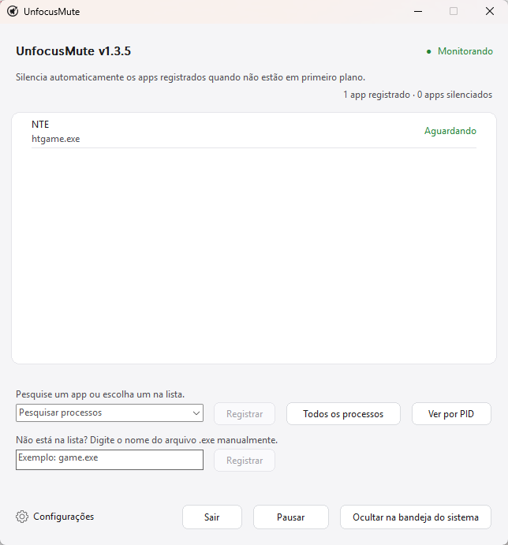

<div align="center">
  

  <h1>UnfocusMute</h1>

  <p><strong>App leve que fica na bandeja do sistema do Windows e silencia automaticamente jogos e apps selecionados quando perdem o foco.</strong></p>

  <p>
    <a href="../README.md">English</a> · <a href="README_ko.md">한국어</a> · <a href="README_ja.md">日本語</a> · <a href="README_zh-CN.md">简体中文</a> · <a href="README_es.md">Español</a> · <a href="README_fr.md">Français</a> · Português · <a href="README_hi.md">हिन्दी</a> · <a href="README_ar.md">العربية</a>
  </p>

  <p>
    <a href="https://github.com/ilsd7/UnfocusMute/actions/workflows/ci.yml"></a>
    &nbsp;
    
    &nbsp;
    <a href="../LICENSE"></a>
  </p>

  <p>Totalmente local &nbsp;·&nbsp; Sem acesso à rede &nbsp;·&nbsp; Sem telemetria &nbsp;·&nbsp; Não requer instalação</p>

  <p>
    <a href="https://github.com/ilsd7/UnfocusMute/releases/latest/download/UnfocusMute-windows-x64.zip">Baixar</a>
    · <a href="#uso">Uso</a>
    · <a href="#segurança-e-privacidade">Privacidade</a>
    · <a href="../LICENSE">Apache-2.0</a>
  </p>
</div>

---

UnfocusMute é um app pequeno e leve que fica na bandeja do sistema do Windows, silencia automaticamente jogos e apps selecionados quando ficam em segundo plano e reativa o som quando voltam ao primeiro plano.

Se um jogo não tiver a opção de silenciar o som em segundo plano, você pode deixá-lo aberto e usar `Alt`+`Tab` para trabalhar em outra janela sem ouvir o jogo. O recurso também funciona com navegadores e reprodutores de mídia. Os apps que você silenciou manualmente continuam silenciados.

O executável nativo, escrito em Rust, ocupa cerca de 600 KB.

<p align="center">
  
</p>

---

## Baixar e executar

A versão x64 funciona no Windows 10 a partir da versão 1703 e no Windows 11.

| Pacote mais recente |
| --- |
| [UnfocusMute-windows-x64.zip](https://github.com/ilsd7/UnfocusMute/releases/latest/download/UnfocusMute-windows-x64.zip) |
| [Arquivo de verificação SHA-256](https://github.com/ilsd7/UnfocusMute/releases/latest/download/UnfocusMute-windows-x64.zip.sha256) · [Notas da versão](https://github.com/ilsd7/UnfocusMute/releases/latest) |

Depois de extrair o ZIP, mova a pasta `UnfocusMute-windows-x64` para o local de sua preferência e execute `UnfocusMute-v<version>.exe`. Não é necessário instalar o app nem ter um runtime adicional ou ferramentas de desenvolvimento.

> **Observação:** Por questões de custo, o UnfocusMute é distribuído sem assinatura de código do Windows. Por isso, na primeira execução, pode aparecer um aviso do Windows SmartScreen ou de "editor desconhecido". Para verificar por conta própria a origem e a integridade do arquivo, consulte [Transparência e verificação dos arquivos de distribuição](#transparência-e-verificação-dos-arquivos-de-distribuição).

<br>

## Uso

1. Abra o UnfocusMute. Na primeira execução, escolha o idioma e as opções de inicialização e clique em `Começar`.
2. Abra o jogo ou app que deseja registrar e reproduza algum som para que ele apareça na lista.
3. Volte ao UnfocusMute, selecione o app e clique em `Registrar`.
4. Mude de janela com `Alt`+`Tab`. O som do app deve parar e voltar quando você retornar a ele.

> **O app não aparece na lista?** Clique em `Todos os processos` ou digite diretamente o nome exato do executável.

### Encontrar o nome do executável

1. Abra o jogo ou app que você quer registrar e depois abra o Gerenciador de Tarefas do Windows.
2. Em `Processos`, ordene a lista pelo uso de `CPU`, do maior para o menor, depois clique com o botão direito no app e selecione `Propriedades`.
3. Confira o nome do executável na janela de propriedades, incluindo a extensão, e registre o app no UnfocusMute.

### Ações comuns

- Clique com o botão direito em um app da lista para pausar ou retomar o monitoramento dele ou removê-lo da lista.
- Se for difícil reconhecer um app pelo nome do arquivo, use `Editar nota` para exibir uma descrição acima do nome na lista.
- Clique no status `Monitorando`, na parte superior, para pausar ou retomar todo o monitoramento.
- Em `Configurações`, você pode alterar a inicialização automática e o comportamento ao fechar a janela.
- Por padrão, o UnfocusMute continua funcionando na bandeja do sistema quando você fecha a janela. Para sair completamente, clique com o botão direito no ícone da bandeja e selecione `Sair`.

<br>

## Comportamentos importantes

**Registro por PID:** O registro pelo nome do executável inclui todas as sessões de áudio dos processos com esse nome. Para silenciar só uma das instâncias abertas, registre apenas o PID dela em `Ver por PID`. Se o PID tiver várias sessões de áudio, todas serão silenciadas juntas. Se o PID mudar ao reiniciar o app, registre o novo PID.

No Windows, a sessão de áudio e a janela em primeiro plano podem ter PIDs diferentes. Por isso, nem sempre é possível identificar a janela que está reproduzindo o som apenas pelo PID. O UnfocusMute reativa o som quando você muda para qualquer janela com o mesmo nome de executável. Não é possível manter uma instância silenciada enquanto você usa outra janela desse executável. Ao trabalhar em outro app, você pode silenciar só o PID registrado e continuar ouvindo as outras instâncias.

**Compatibilidade com sistemas antitrapaça:** O UnfocusMute consulta o Windows para identificar a janela em primeiro plano e usa o CoreAudio para controlar o som. Como funciona fora do jogo, esperamos que seja compatível com a maioria dos sistemas antitrapaça, mas não podemos garantir isso para todos os jogos.

<br>

## Solução de problemas

- **O app está sem som:** Se o UnfocusMute fechar inesperadamente, o app pode continuar silenciado. Abra o `Mixer de volume` do Windows e reative o som desse app.
- **O app não aparece na lista:** Reproduza algum som no app e abra a lista novamente. Se ele ainda não aparecer, [procure o nome do executável](#encontrar-o-nome-do-executável).
- **O app não é silenciado:** Verifique se o status na parte superior é `Monitorando` e se o app registrado não está `Pausado`. O recurso também pode não funcionar se um driver, uma configuração de permissão ou um programa de segurança limitar o acesso às sessões de áudio do Windows.
- **O registro por PID não funciona como esperado:** Confira o [comportamento do registro por PID](#comportamentos-importantes).
- **O status muda para `Atenção`:** Clique em `Detalhes`, ao lado do indicador de status, para ver o erro.

Se o problema continuar, [abra uma issue no GitHub](https://github.com/ilsd7/UnfocusMute/issues/new/choose).

Se você suspeitar de uma vulnerabilidade de segurança, não publique detalhes em uma issue pública. Use o canal de relato privado e consulte [SECURITY.md](../SECURITY.md) para mais informações.

<br>

## Arquivo de configuração

Se precisar verificar ou fazer backup do arquivo de configuração diretamente, clique em `Abrir pasta de configurações` em Configurações. O Explorador de Arquivos abre a pasta `%APPDATA%\UnfocusMute`, onde as configurações são salvas.

Você também pode editar o `config.json` diretamente. Se o formato estiver inválido e não puder ser lido, o UnfocusMute salva uma cópia do arquivo original como `config.invalid-<timestamp>.json` e cria um novo com base nos valores padrão ou nas configurações atuais do app.

<br>

## Segurança e privacidade

O UnfocusMute é totalmente local. Funciona normalmente mesmo sem conexão com a internet e não exige permissões de administrador. Também não faz solicitações de rede automáticas, não usa telemetria, não envia relatórios de falha, não registra logs remotamente nem coleta dados.

Como exceção, o repositório GitHub deste projeto só é aberto no navegador padrão quando você clica no botão `Repositório GitHub` em Configurações.

A detecção de sessões de áudio e o controle de silenciamento usam apenas as APIs CoreAudio do Windows. O UnfocusMute não injeta código nos processos de destino, não lê a memória deles nem intercepta entrada do usuário.

### Informações salvas

O UnfocusMute salva apenas as configurações necessárias para funcionar em `%APPDATA%\UnfocusMute\config.json`.

- Nomes de processos registrados
- PIDs registrados diretamente
- Quais apps registrados foram silenciados pelo UnfocusMute
- Notas que você escrever
- Idioma e configurações escolhidos
- Posição e tamanho da janela

Essas informações não são enviadas para nenhum lugar.

Se você ativar o início automático ao fazer login no Windows, o caminho do executável atual também será salvo no valor `UnfocusMute` em `HKEY_CURRENT_USER\Software\Microsoft\Windows\CurrentVersion\Run`.

### Informações que não são salvas

O UnfocusMute não salva histórico de uso, logs de atividade, logs de erro, dados de áudio, títulos de janelas, teclas digitadas nem qualquer informação que não esteja listada acima em "Informações salvas".

### Remover completamente o UnfocusMute

1. Se você ativou `Iniciar automaticamente ao fazer login no Windows`, desative essa opção primeiro em `Configurações`.
2. Clique com o botão direito no ícone da bandeja e selecione `Sair`.
3. Exclua as pastas `UnfocusMute-windows-x64` e `%APPDATA%\UnfocusMute`.

Se você já tiver excluído o executável e não puder desativar a inicialização automática, exclua o valor `UnfocusMute` em `HKEY_CURRENT_USER\Software\Microsoft\Windows\CurrentVersion\Run`.

<br>

## Transparência e verificação dos arquivos de distribuição

O UnfocusMute foi projetado para ser usado com segurança em ambientes comuns, portanto a maioria dos usuários não precisa seguir as etapas de verificação abaixo. Se você não quiser depender apenas da confiança no desenvolvedor ou der especial importância à segurança da cadeia de fornecimento de software, poderá usar este procedimento público para verificar a origem e a integridade dos arquivos baixados.

### Por que uma verificação separada é necessária

Mesmo que você revise o código-fonte do repositório e conclua que ele é seguro, não é possível presumir que os arquivos de uma versão publicada no GitHub foram realmente criados a partir desse código. Se a conta do desenvolvedor for comprometida ou as permissões de publicação forem usadas indevidamente, arquivos sem relação com o código-fonte publicado poderão ser distribuídos.

A comparação de hashes SHA-256 confirma se um arquivo baixado corresponde à soma de verificação publicada, mas não comprova qual código-fonte e qual ambiente de compilação o produziram.

Para tratar esses riscos da cadeia de fornecimento com transparência, o UnfocusMute publica um método que permite verificar diretamente se um arquivo de uma versão publicada no GitHub é um artefato oficial gerado pelo GitHub Actions a partir do commit indicado pela tag dessa versão.

<details>
<summary>Mostrar as etapas de verificação</summary>

Instale o [GitHub CLI](https://cli.github.com/) e abra o PowerShell na pasta onde você baixou o ZIP. Se também quiser comparar as somas de verificação, salve nessa pasta o arquivo `.sha256` da mesma versão. Substitua o valor de `$version` pela tag da versão que deseja verificar e execute os comandos abaixo.

```powershell
$version = "v1.5.0"
$sourceRef = "refs/tags/$version"
$workflow = "ilsd7/UnfocusMute/.github/workflows/release.yml"

gh attestation verify .\UnfocusMute-windows-x64.zip `
  -R ilsd7/UnfocusMute `
  --source-ref $sourceRef `
  --signer-workflow $workflow
```

Esse comando acessa o serviço de atestação do GitHub e verifica se o SHA-256 do ZIP local corresponde ao valor registrado na procedência da compilação assinada pelo GitHub Actions.

Você também pode comparar o ZIP com o hash SHA-256 publicado na versão.

```powershell
$expectedHash = ((Get-Content .\UnfocusMute-windows-x64.zip.sha256 -TotalCount 1) -split '\s+')[0]
$actualHash = (Get-FileHash .\UnfocusMute-windows-x64.zip -Algorithm SHA256).Hash

if ($actualHash -ne $expectedHash) {
  throw "A verificação SHA-256 falhou."
}

"SHA-256 verificado: $actualHash"
```

Uma verificação bem-sucedida confirma que o ZIP baixado foi gerado pelo workflow indicado do GitHub Actions para a tag de versão especificada e corresponde ao hash registrado em sua atestação.

Isso não prova que o código-fonte em si é seguro, que todo o ambiente do GitHub está íntegro ou que a compilação possa ser reproduzida byte por byte em outro computador.

</details>

<br>

## Compilar a partir do código-fonte

O alvo recomendado para as versões publicadas é `x86_64-pc-windows-msvc`.

Ferramentas necessárias:

- Rust stable
- Visual Studio Build Tools 2022 ou Visual Studio 2022
- Windows 10/11 SDK

Você também precisa do `cargo-about` para atualizar o `THIRD_PARTY_NOTICES.md`.

<details>
<summary>Mostrar comandos de compilação e empacotamento</summary>

```powershell
rustup target add x86_64-pc-windows-msvc
cargo build --release --target x86_64-pc-windows-msvc --locked
```

As compilações de release são configuradas para reduzir o tamanho do binário. O perfil de release em `Cargo.toml` remove símbolos, ativa LTO, usa uma única unidade de geração de código (codegen unit), define `panic = "abort"` e otimiza para tamanho.

Executável:

```text
target\x86_64-pc-windows-msvc\release\unfocusmute.exe
```

ZIP de distribuição:

```powershell
powershell -NoProfile -ExecutionPolicy Bypass -File scripts\package-windows.ps1
```

Quando precisar atualizar os avisos de licenças de terceiros:

```powershell
cargo about generate about.hbs -c about.toml --locked --offline -o THIRD_PARTY_NOTICES.md
```

O resultado é criado em `dist\UnfocusMute-windows-x64.zip`, com um arquivo de verificação SHA-256 em `dist\UnfocusMute-windows-x64.zip.sha256`. O ZIP inclui o executável com versão (`UnfocusMute-v<version>.exe`), `LICENSE` e `THIRD_PARTY_NOTICES.md`.

</details>

<br>

## Licença

Apache License 2.0. Veja [LICENSE](../LICENSE) para mais detalhes.

Veja [THIRD_PARTY_NOTICES.md](../THIRD_PARTY_NOTICES.md) para os avisos de licenças de crates Rust de terceiros.
