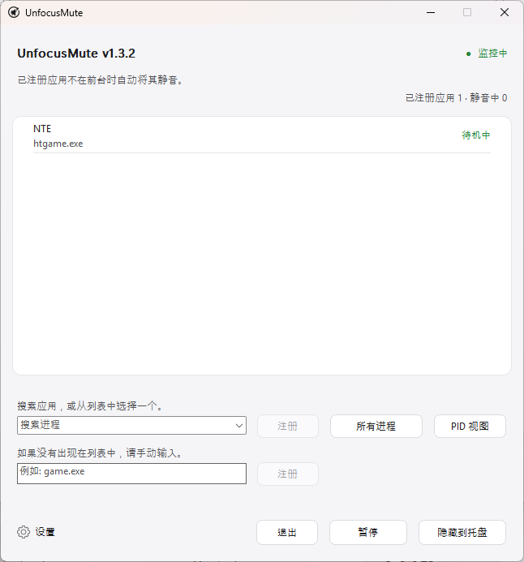

<div align="center">
  

  <h1>UnfocusMute</h1>

  <p><strong>轻量级 Windows 托盘应用，可在所选游戏或应用失去焦点时自动静音。</strong></p>

  <p>
    <a href="../README.md">English</a> · <a href="README_ko.md">한국어</a> · <a href="README_ja.md">日本語</a> · 简体中文 · <a href="README_es.md">Español</a> · <a href="README_fr.md">Français</a> · <a href="README_pt.md">Português</a> · <a href="README_hi.md">हिन्दी</a> · <a href="README_ar.md">العربية</a>
  </p>

  <p>
    <a href="https://github.com/ilsd7/UnfocusMute/actions/workflows/ci.yml"></a>
    &nbsp;
    
    &nbsp;
    <a href="../LICENSE"></a>
  </p>

  <p>完全本地运行 &nbsp;·&nbsp; 无网络访问 &nbsp;·&nbsp; 无遥测 &nbsp;·&nbsp; 免安装</p>

  <p>
    <a href="https://github.com/ilsd7/UnfocusMute/releases/latest/download/UnfocusMute-windows-x64.zip">下载</a>
    · <a href="#使用方法">使用方法</a>
    · <a href="#安全与隐私">隐私</a>
    · <a href="../LICENSE">Apache-2.0</a>
  </p>
</div>

---

UnfocusMute 是一款小巧轻量的 Windows 托盘应用，可在所选游戏或应用转入后台时自动静音，并在回到前台时解除静音。

如果游戏没有后台静音选项，你可以让游戏继续运行，用 `Alt`+`Tab` 切换到其他窗口工作，这段时间游戏会保持静音。浏览器和媒体播放器也可以这样设置。UnfocusMute 只会恢复它自己静音的应用。手动静音的应用会保持静音。

这款原生应用使用 Rust 编写，可执行文件约 600 KB。

<p align="center">
  
</p>

---

## 下载与运行

x64 版支持 Windows 10 版本 1703 及更高版本，以及 Windows 11。

| 最新发布包 |
| --- |
| [UnfocusMute-windows-x64.zip](https://github.com/ilsd7/UnfocusMute/releases/latest/download/UnfocusMute-windows-x64.zip) |
| [SHA-256 校验和文件](https://github.com/ilsd7/UnfocusMute/releases/latest/download/UnfocusMute-windows-x64.zip.sha256) · [发布说明](https://github.com/ilsd7/UnfocusMute/releases/latest) |

解压后，将 `UnfocusMute-windows-x64` 文件夹移动到你想保存的位置，再运行其中的 `UnfocusMute-v<version>.exe`。无需安装，也无需额外的运行库或开发工具。

> **提示：** 出于成本考虑，UnfocusMute 发布时未进行 Windows 代码签名。因此，首次运行时可能会出现 SmartScreen 或“未知发布者”警告。如需自行确认文件来源和完整性，请参阅[透明度与发布文件验证](#透明度与发布文件验证)。

<br>

## 使用方法

1. 启动 UnfocusMute。首次运行时，请选择语言和启动选项，然后点击 `开始`。
2. 启动要添加的游戏或应用，并播放一次声音，让它出现在列表中。
3. 返回 UnfocusMute，从列表中选择应用并点击 `添加`。
4. 用 `Alt`+`Tab` 切换到其他窗口，确认已添加的应用静音。切回该应用时，声音应当恢复。

> **列表里找不到应用？** 点击 `所有进程`，或直接输入准确的可执行文件名。

### 查找可执行文件名

1. 启动要添加的游戏或应用，然后打开 Windows 任务管理器。
2. 在 `进程` 列表中按 `CPU` 使用率从高到低排序，然后右键点击目标应用，选择 `属性`。
3. 在属性窗口中确认可执行文件的完整名称（包括扩展名），然后在 UnfocusMute 中添加该应用。

### 常用操作

- 右键点击列表中的应用，可以暂停或恢复对它的监控，也可以将它从列表中移除。
- 如果很难凭文件名辨认应用，可以用 `编辑备注` 添加说明。备注会显示在列表中的文件名上方。
- 点击顶部的 `监控中` 状态，可以暂停或恢复全部监控。
- 在 `设置` 中可以更改自动启动和关闭窗口时的行为。
- 默认情况下，关闭窗口后，UnfocusMute 会继续在系统托盘中运行。 要完全退出，请右键点击托盘图标并选择 `退出`。

<br>

## 需要了解的行为

**按 PID 添加：** 按可执行文件名添加时，所有同名进程的音频会话都会成为静音目标。如果同时运行了多个实例，只想让其中一个静音，可以在 `PID 视图` 中只添加它的 PID。同一 PID 下的多个音频会话会一起静音。如果重启应用后 PID 发生变化，请添加新的 PID。

在 Windows 中，音频会话和前台窗口的 PID 可能不同，仅凭 PID 有时无法判断声音来自哪个窗口。因此，切换到可执行文件同名的窗口时，UnfocusMute 会视为已返回注册的应用，并恢复声音。使用同一应用的另一个窗口时，无法让某个 PID 持续静音。切换到其他应用工作时，仍可以让注册的 PID 单独静音，同时听到其他实例的声音。

**反作弊兼容性：** UnfocusMute 通过 Windows 获取前台窗口信息，并通过 CoreAudio 控制声音。由于它在游戏进程之外工作，预计可以与大多数反作弊系统兼容，但无法保证适用于所有游戏。

<br>

## 故障排查

- **听不到应用的声音：** 如果 UnfocusMute 异常退出，应用可能会保持静音。请打开 Windows 的 `音量合成器`，为该应用解除静音。
- **应用未出现在列表中：** 在应用中播放声音，然后重新打开列表。如果仍然找不到应用，请[查找可执行文件名](#查找可执行文件名)。
- **应用没有静音：** 确认顶部状态为 `监控中`，且已添加的应用没有处于 `已暂停` 状态。如果驱动、权限设置或安全软件限制了对 Windows 音频会话的访问，也可能无法正常静音。
- **按 PID 添加的行为不符合预期：** 请参阅[按 PID 添加的行为](#需要了解的行为)。
- **状态变为 `需要注意`：** 点击状态旁边的 `详情` 查看错误内容。

如果问题仍然存在，请[提交 GitHub Issue](https://github.com/ilsd7/UnfocusMute/issues/new/choose)。

如果怀疑存在安全漏洞，请勿在公开 Issue 中发布细节，而应通过私密渠道报告。具体方法请参阅 [SECURITY.md](../SECURITY.md)。

<br>

## 设置文件

如果需要直接查看或备份设置文件，请点击设置界面的 `打开设置文件夹` 按钮。文件资源管理器会打开保存设置文件的 `%APPDATA%\UnfocusMute` 文件夹。

你也可以直接编辑 `config.json`。如果格式错误且无法读取，原文件会先备份为 `config.invalid-<timestamp>.json`，然后根据默认值或应用当前的设置创建新的设置文件。

<br>

## 安全与隐私

UnfocusMute 是完全在本地运行的应用。即使没有互联网连接也能正常工作，并且不需要管理员权限。它也不会发起自动网络请求、发送遥测数据、崩溃报告或远程日志，也不会收集数据。

作为例外，只有当你在设置界面点击 `GitHub 仓库` 按钮时，才会在默认浏览器中打开本项目的 GitHub 仓库。

音频会话检测和静音控制只使用 Windows CoreAudio API。UnfocusMute 不会向目标进程注入代码，不会读取其内存，也不会拦截输入。

### 保存的信息

UnfocusMute 只会把运行所需的设置保存到 `%APPDATA%\UnfocusMute\config.json`。

- 已添加的进程名
- 手动添加的 PID
- UnfocusMute 是否已将各个已添加的应用静音
- 你添加的备注
- 选择的语言和设置
- 窗口位置和大小

这些信息不会发送到任何地方。

不过，如果你开启 `Windows 登录时自动启动`，当前可执行文件路径也会保存到 `HKEY_CURRENT_USER\Software\Microsoft\Windows\CurrentVersion\Run` 下的 `UnfocusMute` 值中。

### 不保存的信息

除上面“保存的信息”中列出的项目外，其他信息均不会保存。使用记录、活动日志、错误日志、音频数据、窗口标题和按键输入也不会保存。

### 彻底删除

1. 如果开启了 `Windows 登录时自动启动`，请先在 `设置` 中将其关闭。
2. 右键点击托盘图标，选择 `退出`，关闭 UnfocusMute。
3. 删除 `UnfocusMute-windows-x64` 文件夹和 `%APPDATA%\UnfocusMute` 文件夹。

如果在关闭自动启动前就删除了可执行文件，请删除 `HKEY_CURRENT_USER\Software\Microsoft\Windows\CurrentVersion\Run` 下的 `UnfocusMute` 值。

<br>

## 透明度与发布文件验证

UnfocusMute 旨在一般使用环境中安全运行，因此大多数用户无需另外执行以下验证步骤。如果你不希望仅依赖对开发者的信任，或特别重视软件供应链安全，可以按照公开步骤验证下载文件的来源和完整性。

### 为什么需要单独验证

即使亲自检查仓库中的源代码并认为它是安全的，也不能断定 GitHub 发布版本中的文件确实由该源代码构建而成。如果开发者账号被盗或发布权限遭到滥用，可能会分发与公开源代码无关的文件。

比较 SHA-256 哈希可以确认下载的文件是否与公开的校验和一致，但无法证明它基于哪些源代码、在何种构建环境中生成。

为了透明地应对这些供应链风险，UnfocusMute 公开了验证方法，可直接确认 GitHub 发布版本中的文件是否为 GitHub Actions 基于相应发布标签所指向的提交生成的官方构建产物。

<details>
<summary>查看发布文件验证步骤</summary>

安装 [GitHub CLI](https://cli.github.com/)，然后在下载 ZIP 的文件夹中打开 PowerShell。如果还要比对校验和，请把同一版本的 `.sha256` 文件也保存在该文件夹中。将下面的 `$version` 改为要验证的发布标签，然后运行命令。

```powershell
$version = "v1.5.0"
$sourceRef = "refs/tags/$version"
$workflow = "ilsd7/UnfocusMute/.github/workflows/release.yml"

gh attestation verify .\UnfocusMute-windows-x64.zip `
  -R ilsd7/UnfocusMute `
  --source-ref $sourceRef `
  --signer-workflow $workflow
```

此命令会连接 GitHub attestation 服务，检查本地 ZIP 的 SHA-256 是否与由 GitHub Actions 签名的构建来源证明中记录的值一致。

还可以将 ZIP 与发布版本中公开的 SHA-256 哈希进行比较。

```powershell
$expectedHash = ((Get-Content .\UnfocusMute-windows-x64.zip.sha256 -TotalCount 1) -split '\s+')[0]
$actualHash = (Get-FileHash .\UnfocusMute-windows-x64.zip -Algorithm SHA256).Hash

if ($actualHash -ne $expectedHash) {
  throw "SHA-256 验证失败。"
}

"SHA-256 验证成功：$actualHash"
```

验证成功后，即可确认下载的 ZIP 由指定 GitHub Actions 工作流基于给定发布标签生成，并与 attestation 中记录的哈希一致。

但这并不能证明源代码本身是安全的、整个 GitHub 环境未受破坏，也不能证明该构建可在其他计算机上逐字节重现。

</details>

<br>

## 自行构建

推荐的发布目标是 `x86_64-pc-windows-msvc`。

所需工具：

- Rust stable
- Visual Studio Build Tools 2022 或 Visual Studio 2022
- Windows 10/11 SDK

更新 `THIRD_PARTY_NOTICES.md` 时还需要安装 `cargo-about`。

<details>
<summary>查看构建和打包命令</summary>

```powershell
rustup target add x86_64-pc-windows-msvc
cargo build --release --target x86_64-pc-windows-msvc --locked
```

发布构建已针对较小体积进行配置。`Cargo.toml` 的发布配置会剥离符号、启用 LTO、使用单个代码生成单元（codegen unit）、设置 `panic = "abort"`，并优先优化体积。

可执行文件：

```text
target\x86_64-pc-windows-msvc\release\unfocusmute.exe
```

发布 ZIP：

```powershell
powershell -NoProfile -ExecutionPolicy Bypass -File scripts\package-windows.ps1
```

需要更新第三方许可证声明时：

```powershell
cargo about generate about.hbs -c about.toml --locked --offline -o THIRD_PARTY_NOTICES.md
```

结果会生成到 `dist\UnfocusMute-windows-x64.zip`，同一位置还会生成用于 SHA-256 校验的 `dist\UnfocusMute-windows-x64.zip.sha256`。ZIP 包含带版本号的可执行文件（`UnfocusMute-v<version>.exe`）、`LICENSE` 和 `THIRD_PARTY_NOTICES.md`。

</details>

<br>

## 许可证

Apache License 2.0。详情请查看 [LICENSE](../LICENSE)。

第三方 Rust crate 许可证声明请查看 [THIRD_PARTY_NOTICES.md](../THIRD_PARTY_NOTICES.md)。
